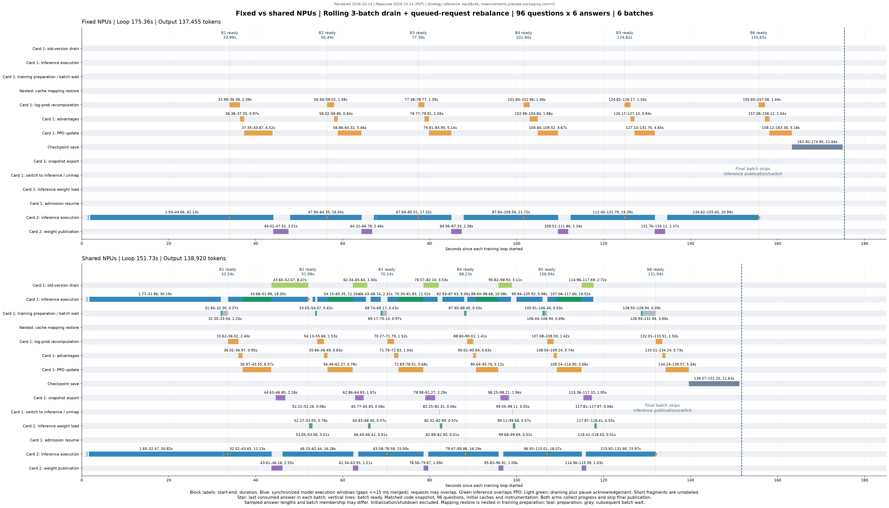
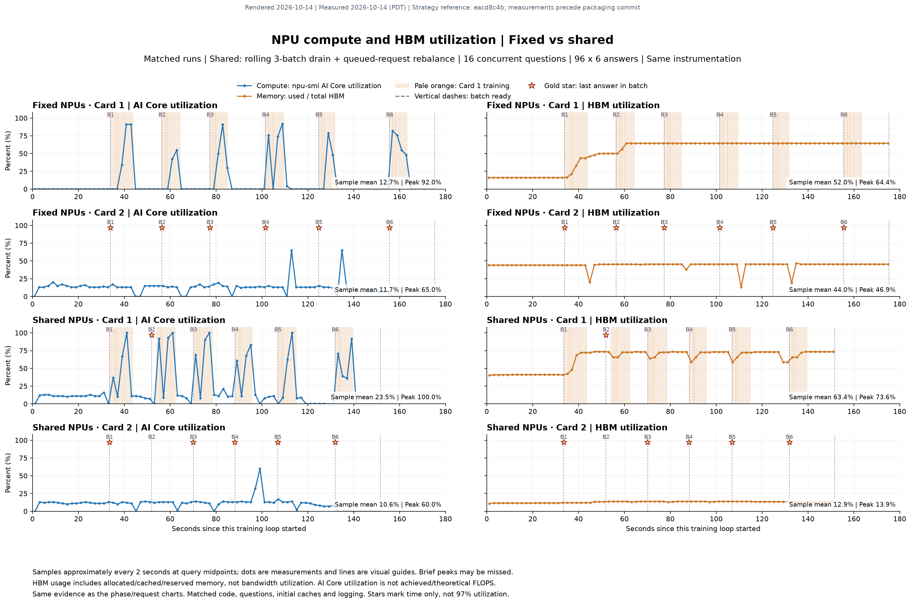
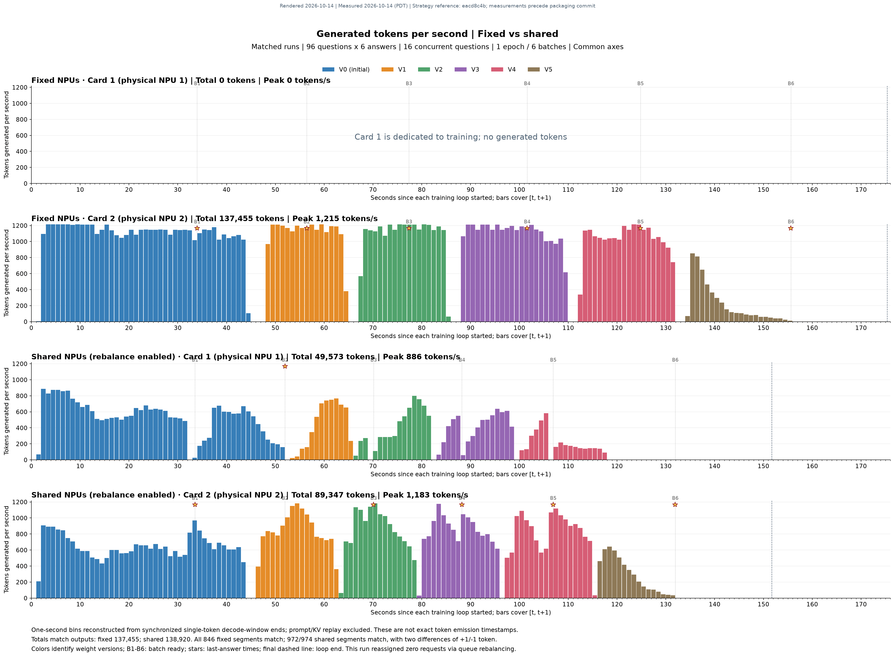

# Shared NPU inference and training (experimental)

The feature switch is `npu_share`, which defaults to `false` and preserves the existing
execution mode. When enabled, training and inference share an NPU with automatic memory
budgeting: retain resident state when possible, reclaim KV memory first, and offload
weights or training state to CPU as needed. Insufficient memory after reclamation is an
error.

```yaml
npu_share: true
```

This replaces the development fields `resident_colocation` and
`colocation_memory.enabled`. There is no separate time-sharing mode that disables
automatic offload. `colocation_memory` contains advanced budgets only. Disabling the
feature does not change resource placement; restore the original resource configuration
when returning to a conventional deployment.

## Current implementation

The implementation supports single-card switching and a two-card inference pool. In the
two-card layout, one card remains dedicated to inference; the other serves inference or
training as required. Placement and backend constraints must match the corresponding
example.

- Memory budgets, dynamic physical KV pages, and pressure-based reclamation retain
  resident state where possible. Experimental concurrent inference reserves training
  memory first; concurrency is conditional.
- The fixed inference replica resumes after its own HCCL update completes. Shared
  snapshot loading, memory switching, and some cleanup run in the background. The final
  batch skips unnecessary inference restoration.
- Request migration and continuation remain the default. Same-card retained pause is a
  separate experiment. Cross-card continuation rebuilds the prefix and does not transfer
  KV cache between cards.
- Optional adaptive draining uses the latest three frozen batch windows, or all
  available windows during startup. Cost-aware rebalancing after shared-card restoration
  considers only requests that have never executed.
- Synchronized NPU timing is disabled by default. Request tracing and drain telemetry
  have separate controls.

Historical implementation and measurement sections below are explicitly labeled. Their
restrictions do not describe every current mode. Later sections define the current
asymmetric publication, pressure reclamation, training-priority mode, three-window
estimator, and queue rebalancing. Performance is workload-dependent; this experimental
feature does not guarantee a speedup.

## Initial single-card sequence (historical)

1. vLLM produces a training batch.
1. Stop new dispatch, pause vLLM, abort in-flight requests, and clear KV cache.
1. FSDP computes probabilities, advantages, and gradients and updates parameters and
   optimizer state.
1. The training worker exports weights and synchronizes its device stream (disk stage
   0).
1. Paused vLLM loads the weights (disk stage 1).
1. Commit the version, resume generation, and perform scheduled evaluation, cleanup, and
   logging before resuming training dispatch.

This initial pause uses AReaL's abort/retry semantics rather than waiting for long agent
tasks to finish. The first version required `max_head_offpolicyness: 0` and did not
overlap batch prefetch computation or retain multiple weight versions. The optimizer
persists in the same process; switching does not recreate it or reset Adam state. Weight
export, loading, or wakeup failures keep inference paused. Terminate and inspect the
failed experiment rather than manually resuming potentially incomplete weights.

## Running the single-card example

`examples/math/gsm8k_grpo_single_npu.yaml` defaults to two batches, two questions per
batch, four answers per question, and at most 256 generated tokens.

```bash
export ASCEND_RT_VISIBLE_DEVICES=<available-device-id>
python3 examples/math/gsm8k_rl.py \
  --config examples/math/gsm8k_grpo_single_npu.yaml \
  actor.path=<local-model-directory> \
  train_dataset.path=<local-gsm8k-directory> \
  valid_dataset.path=<local-gsm8k-directory> \
  cluster.fileroot=<experiment-output-directory>
```

Existing scheduling uses `rollout.scheduling_strategy.type: colocation`,
`target: actor`, and `fork: true` to assign both processes the same device. No scheduler
replacement is required. `vllm.gpu_memory_utilization: 0.3` is a small-model starting
point, not a memory safety guarantee. Adjust it for the model, sequence length, and
measured peak, and verify the device is available.

The initial single-card example supports a local single controller, single-device
FSDP/vLLM v1 controllers, disk weight updates, eager full-model execution, the `uni`
executor, FSDP `memory_efficient_load`, and ordinary AdamW. Auxiliary models, LoRA,
online agents, recovery, and additional offload implementations are not supported.
Unsupported settings fail before model workers start. Conventional separate-card
execution remains available with `npu_share: false`.

## Validation

```bash
python3 -m pytest -q tests/test_resident_colocation.py tests/test_generation_gate.py
```

These tests exercise trainer transition ordering, version commits, configuration
constraints, and server failure handling with mocked RPC boundaries. They do not replace
Ascend training. Hardware validation must also verify consecutive optimizer steps,
correct inference versions, shared device placement, and HBM peaks. Use a compatible
vLLM/vLLM-Ascend environment: vLLM 0.14.1 in the old AReaL v1.0.1 image does not
implement the same token-in/token-out service interface.

### Initial resident-mode measurements (historical)

On 2026-10-06, a 64 GiB Ascend 910B2 completed a small end-to-end run with
Qwen2.5-1.5B-Instruct, four training questions, two evaluation questions, four answers
per question, and two optimizer updates. The container exited normally; the optimizer
instance stayed unchanged and Adam steps advanced from 1 to 2. Training answers used
versions 0 and 1, evaluation used version 2, and both loads succeeded.

The environment used torch 2.10.0, torch-npu 2.10.0.post4, Transformers 5.14.1, vLLM
0.26.0, triton-ascend 3.2.2, and the vLLM-Ascend revision specified by `Dockerfile.a2`,
built independently in a CANN 9.1.0 A2 image. Its older logging headers needed an
error-logging compatibility macro; real runtime libraries must take precedence over
devlib stubs.

Initialization took about 258 s and the loop including final evaluation about 91 s. HBM
sampled every 2 s peaked at 52,112 MiB. This validates switching and optimizer
continuity, not large-model capacity, long-run stability, training quality, or
superiority over separate cards.

## KV slab adapter

`examples/math/gsm8k_grpo_single_npu_kv_slab.yaml` demonstrates the Ascend adapter. All
three single-NPU examples enable automatic policy through `npu_share: true`. The
allocation policy follows FineServe's `KVSlabTable`: fill partially occupied slabs
before empty ones, with 16 vLLM blocks per slab by default. Source and BSD attribution
are in `licenses/FineServe.txt`. The adapter is not automatically enabled with
`npu_share: false`.

Sharing now defaults to dynamic physical KV pages. Native Ascend per-layer K/V tensor
layout and a large virtual range are retained without allocating HBM for the entire
range. The native ACL allocator reserves addresses and maps/unmaps at the device's
minimum physical page granularity. Logical slab packing remains; one physical page can
cover several logical slabs.

Mapping precedes vLLM request-state updates, including new-block zeroing. Reclamation
accounts for all retained requests, not just the current scheduled set. The null page
stays mapped and new pages are zeroed. Topology changes synchronize the device before
reclaiming whole idle pages. One idle page group is retained by default to reduce
allocation churn. Budget checks reserve inference workspace and safety margin. Budget or
mapping failures terminate explicitly; they do not skip computation or retry
automatically. Failed workers cannot resume admission. Scheduler-side budget
backpressure is not implemented.

`AREAL_DYNAMIC_KV=0` selects the earlier whole-pool CaMem implementation for A/B
comparisons. Dynamic pages support only the constrained single-device Qwen2 eager
full-attention configuration described below, without KV block copy. Old blocks of
preempted requests can remain conservatively retained until state cleanup. FineServe
CUDA IPC, a multi-model shared KV pool, and cross-card KV migration are not implemented.
The native library is compiled at first startup with CANN headers and g++ into a
temporary cache. `AREAL_DYNAMIC_KV_LIBRARY` can specify a device/ABI-compatible prebuilt
library. `DYNAMIC_KV_INIT` and `DYNAMIC_KV_RESIZE` distinguish virtual capacity from
physical `mapped_bytes`.

The earlier implementation placed native KV in a separate CaMem pool, unmapped the whole
pool under pressure, and zeroed it on restoration. Historical results below refer to
that implementation, not dynamic physical occupancy. Default migration aborts requests
and discards their cache; it does not retain old KV across weight versions for long
agent tasks.

Supported settings are vLLM 0.26.0 with the matching Ascend backend, a single-device
`uni` executor, Qwen2 full attention, native KV dtype, and eager mode. Disable prefix
caching, sleep, speculative decoding, and KV transfer. LoRA updates are outside
validation scope; full XCCL/HCCL publication remains available. Set
`AREAL_KV_SLAB_BLOCKS=16` in worker environment and
`PYTORCH_NPU_ALLOC_CONF=expandable_segments:False` for independent pools.

`KV_SLAB_POOL` and `KV_SLAB_STATS` report actual scheduler allocation counters;
`KV_SLAB_MEMORY_INIT` reports managed bytes; `KV_SLAB_MEMORY` reports mapping state and
device free-memory changes.

```bash
python3 -m pytest -q tests/test_kv_slab.py tests/test_generation_gate.py tests/test_resident_colocation.py
```

### Initial KV-only reclamation measurements (historical)

On 2026-10-06, the same Ascend 910B2 completed four training and two evaluation
questions. The scheduler managed 276 logical slabs and 4,409 usable blocks, plus
reserved null block 0. Allocation/release counts before the two training steps were
21/21 and 43/43, with no live blocks at release. The KV pool managed 16,206,790,656
bytes (15.09 GiB); each release increased free device memory by 16,301,162,496 bytes
(15.18 GiB), including backend allocator-cache cleanup. Each remapping occupied 15.09
GiB and generation resumed successfully.

The same optimizer completed steps 1 and 2 and evaluation succeeded. Initialization took
about 238 s, the loop including evaluation about 90 s, and 2-second HBM samples peaked
at 54,192 MiB (52.92 GiB). This functional test does not establish throughput gains.
Releasing KV during training need not lower the whole-run peak: training allocator
caches can remain when inference resumes. This earlier KV-only mode did not reclaim
training weights or optimizer state. Thirty unit tests passed. Hardware checks also
exercised Ascend import ordering, native CaMem mapping, and real scheduler hooks that
mocks cannot validate.

## Initial automatic memory policy and CPU offload (historical)

`npu_share: true` enables both time sharing and memory management.
`examples/math/gsm8k_grpo_single_npu_auto_memory.yaml` lists advanced budgets. The
initial validated scope was single Ascend, Qwen2, FSDP2 AdamW, vLLM uni/eager, and disk
updates. `actor.fsdp.memory_efficient_load: true` loads weights on CPU before creating
FSDP device storage in the selected pool. Initialization verifies parameter and buffer
storage coverage.

After closing admission, pausing the scheduler, and clearing requests, the initial
policy selected actions in increasing cost order:

1. Retain everything if free memory satisfies the next training budget.
1. Otherwise discard KV and recheck available memory.
1. If necessary, back up inference weights to CPU and release their physical HBM.
1. Restore training parameters and optimizer state only after the budget passes;
   otherwise remain paused and fail.

The initial return-to-inference path exported weights and statistics, released gradients
and allocator caches, and offloaded training parameters and Adam state if inference
restoration still needed memory. Startup also checked memory before loading inference
and offloaded training state when necessary. Current pressure-based reclamation below
supersedes the whole-pool policy.

CaMem preserves virtual addresses and copies restored data back to those addresses,
without replacing Parameter or optimizer objects. This initial KV path discarded
contents and zeroed them on restore. Unknown allocations, live KV blocks, CPU-copy
errors, or partial mapping errors prevent resumption. Partial mapping failure requires
process termination rather than retries or manual admission changes.

Budgets include storage awaiting restoration, uninitialized Adam state, gradients,
workspace, and safety margin, in GiB:

```yaml
colocation_memory:
  train_workspace_gib: 8.0
  inference_workspace_gib: 2.0
  safety_margin_gib: 2.0
  device_budget_gib: null
```

`device_budget_gib: null` uses actual free device memory. A lower cap can reserve
capacity or exercise constrained paths; it never fabricates free memory or permits more
than physically available. Workspace values must match the model, sequence length,
microbatches, and backend. They are not exact predictions of arbitrary peaks. Decisions
precede stage execution; partially executed optimizer steps are not replayed after OOM.
`AUTO_MEMORY` records decisions and required/ available bytes. `AUTO_MEMORY_ACTOR` and
`AUTO_MEMORY_INFERENCE` report pool state, restoration bytes, and CPU backups.

### Initial automatic-policy hardware validation

On 2026-10-06, Qwen2.5-1.5B-Instruct on the same Ascend 910B2 completed four questions
over two epochs, four optimizer updates, and two evaluation questions after each epoch.
Handoff budgets were `null / 48 / 37.5 / 37.5 GiB`; only the budget changed, without
forcing actions or changing physical capacity.

| Step | Before training                                               | Returning to inference                                        |
| ---- | ------------------------------------------------------------- | ------------------------------------------------------------- |
| 1    | Retain inference and training state                           | Retain state                                                  |
| 2    | Release KV only                                               | Restore KV; retain training state                             |
| 3    | Release KV; back up inference weights to CPU                  | Back up training parameters and Adam state; restore inference |
| 4    | Release KV; back up inference weights; restore training state | Offload training state again; restore inference               |

Training backups totaled 20,134,756,352 bytes (18.75 GiB). Both restoration checks
preserved optimizer identity, storage addresses, shapes, and dtypes. Byte hashes of the
first and last eight elements of each tensor matched; this is sampled validation, not a
full checksum. The optimizer completed steps 1–4 with nonzero gradients. Generation used
versions 0–3 and evaluation versions 2 and 4, without cross-version answers.
Initialization took about 318 s and the loop including evaluation 157 s. These
functional results do not prove offload speedups or large-model capacity. Forty-eight
tests passed; decisions, CPU round trips, optimizer audits, and NPU samples were
retained separately. Other models and multi-card execution were not covered by this
initial run.

## Initial two-card inference pool (historical)

`gsm8k_grpo_npu_share_pool.yaml` combines `npu_share: true`,
`rollout.backend: vllm:d2p1t1`, and training `fsdp:d1p1t1`. Local placement puts replica
0 on the training card and replica 1 on the other card. Optimizer state always belongs
to the training card and is not transferred between cards. Disabling sharing disables
this borrowing policy.

The initial policy alternated new question workflows between replicas, stopped
shared-replica admission near 75% batch completion, and paused shared inference when a
complete batch reached training. The fixed replica continued later rollouts. After
training, both inference services paused for loading, committed the same version after
both loads, and resumed. Following evaluation and cleanup, the shared card rejoined
unless the next batch was already ready. Later sections replace the 75% threshold and
synchronous publication.

The pool requires `max_head_offpolicyness >= 1`, a fixed batch size, and inline
workflows; the example uses 2. Early withdrawal cannot guarantee natural request
completion. Interrupted answers retain per-token versions through continuation.
Switching does not guarantee zero idle time or higher throughput. `NPU_SHARE_POOL`
records dispatch, withdraw, batch_ready, borrowed, and returned.

### Initial two-card validation

On 2026-10-06, two Ascend 910B2 cards and Qwen2.5-1.5B-Instruct completed four updates
with 16 questions per batch, four answers per question, and at most 512 tokens.
Reclaiming the shared card took 0.83–1.05 s. The fixed card completed 20, 15, 16, and 16
answers during the four training windows. The shared card rejoined after every update,
publishing versions 1–4. All gradient norms were nonzero and the process exited
normally. Initialization took about 343 s, the loop 118 s, and each publication 7.4–8.0
s. There was no epoch-end evaluation or matched baseline, so this establishes
functionality rather than quality or throughput gains. Sixty-five related tests passed.

## Fast shared-weight snapshots

Sharing uses flat memory-mapped snapshots for internal publication while retaining the
two-stage `actor.weight_update_mode: disk` coordination interface. Publication no longer
exports the full HF model/config/tokenizer each time; regular training checkpoints still
use HF format. No additional feature switch is required.

The actor converts parameters to inference dtype on NPU, copies tensor layouts to an
independent CPU-mapped file, and atomically publishes a versioned manifest. Replicas
validate version, sizes, tensor bounds, and parameter names before loading through the
model's `load_weights`, retaining Ascend postprocessing and device synchronization. The
historical synchronous path waited for both replicas. Current two-card publication
resumes the fixed replica first, then admits the shared replica after its confirmed
load. Failed shared replicas remain outside the pool and propagate errors to training.

Snapshots use the configured weight-exchange directory, preferably tmpfs. Filesystem
addressing and lifecycle remain involved; this is not universally disk-free.
`posix_fallocate` reserves capacity before writing to avoid SIGBUS on sparse tmpfs
files. Extra CPU storage is approximately one inference-dtype model. The colocated
training and inference processes do not share an HCCL group.

`NPU_WEIGHT_SNAPSHOT` records export/load duration, subject to vLLM log settings; actor
RPC timings also support comparisons. Budget checks remain intact, and snapshots own
independent CPU data before training parameters may be offloaded.

### Snapshot measurements (historical)

On 2026-10-06, a two-update smoke test and 16-batch run used two Ascend 910B2 cards,
Qwen2.5-1.5B-Instruct, 256 questions, 16 questions per batch, four answers per question,
at most 1024 tokens, and `max_head_offpolicyness=2`. Shared configurations and launch
scripts were unchanged before/after optimization.

| Metric                                                          | Fixed two-card XCCL | Shared HF publication | Shared snapshots |
| --------------------------------------------------------------- | ------------------: | --------------------: | ---------------: |
| Total publication                                               |             14.54 s |              124.69 s |          83.16 s |
| Training through final publication                              |            340.56 s |              409.71 s |         393.60 s |
| Full loop including saving/evaluation, excluding initialization |            397.32 s |              459.42 s |         426.58 s |

Mean publication fell from 7.79 to 5.20 s (33.3%); snapshot export averaged 2.01 s. The
loop shortened 7.15%, including evaluation variability; training through final
publication shortened about 3.9%. The full loop remained about 7.4% slower than fixed
cards. Each arm ran once, with differing asynchronous answer lengths and ordering, so
these are not statistical conclusions. Eighty tests passed. An NPU copy check matched
24,000 BF16 values, two independent readers, and H2D round trips. The full run completed
16 publications and 64 evaluation answers, without establishing training-quality
improvement. Artifacts were retained under `<experiment-root>/npu-share-fast01` and
baseline `npu-share-ab01`.

### Asymmetric two-card publication

After inference reserves memory and training state is restored, sharing asynchronously
prewarms the AdamW pool. It rechecks physical free memory and the device cap, reserving
inference workspace and safety margin. Insufficient memory creates only the pool, not
optimizer state. Initialization performs no optimizer update: step remains zero and
weights, gradients, and learning rate are unchanged. State is published only after
device-stream completion. Training, memory transitions, save/load, and destruction join
this job and propagate failures. CaMem borrows Python callback pointers without
incrementing their reference counts; the allocator singleton retains the exact callback
objects beyond pool creation and through later allocation/free operations.

Pure `colocation_memory("status")` retains coverage checks and budget information
without device synchronization or `empty_cache()`. Transition cleanup remains in
`restore`, `finish_train`, and `offload` as required by the selected policy. Status
waits for pending prewarm before reading pool inventories.

In two-replica sharing, the actor prepares HCCL buckets while an independent snapshot
thread reads the same version's local weights, converts dtype, and prepares the CPU
snapshot. It does not start another FSDP collective traversal. The fixed replica waits
only for its HCCL handle and load ACK, commits its version, and resumes without waiting
for the snapshot. The communication group contains the actor and fixed replica only; the
fixed replica uses logical rank 0. The colocated inference process is excluded.
Single-replica sharing uses snapshots; nonshared execution retains its original
publication path.

After fixed-replica readiness, an ordinary step enters the next `prepare_batch`. A
background thread joins `wait_shared_snapshot(version)`, collects actor statistics,
switches shared memory, loads and acknowledges the snapshot, and cleans up/logs the
previous batch. Shared admission opens only after load ACK, version commit, and
generation resume. The next training step must join the whole background tail before
borrowing the card or mutating parameters.

The fused path requires one actor rank, no LoRA, and one HCCL receiver group. Snapshot
D2H copies synchronize a dedicated device stream. The thread directly reads full
single-rank local parameter storage and converts one tensor at a time; an initial event
fences the preceding optimizer update. HCCL does not enqueue snapshot tensors and is not
subject to snapshot-queue backpressure. At most one extra converted tensor is retained,
not a full additional device model. Snapshot completion requires atomic manifest
publication. The HCCL completion path has no snapshot join or whole-device
synchronization, although device-bandwidth contention remains possible. Exceptions drain
submitted work and keep the shared replica closed; an already-acknowledged fixed replica
retains valid new weights.

This background tail is automatic in two-card asymmetric sharing. Evaluation boundaries
remain synchronous. Data-service cleanup occurs before fixed-card publication and is not
repeated in the background, preserving cleanup-before-read ordering even though the
current worker cleanup is a no-op. Fixed-card and single-card modes retain synchronous
cleanup. Exit, including exceptions, joins the tail before destroying workers;
background failures wake batch waiters. Next-batch rollout timing is recorded after
prior-batch logging to avoid mixing statistics.

Training, evaluation, subsequent publication, and shutdown fence unfinished shared
loads. Failures keep shared admission closed and call `dispatcher.fail_fast` to avoid
silent hangs. Failed snapshots remain for diagnosis; successful ones are cleaned up.
Proxy-dependent AgentWorkflow is explicitly unsupported in this mode.

`NPU_SHARE_POOL` events `fixed_ready`, `shared_load_start`, `returned`, and
`shared_load_failed` record versions and timing. `train.update_weights` excludes some
background work; ordinary steps wait only for fixed publication.
`train.background_publication`, `train.shared_memory_switch`, and
`train.wait_previous_tail` expose the other intervals. `fixed_hccl_complete` includes
load ACK and `snapshot_mode=independent_reader`; `snapshot_submit_seconds=0` is a
compatibility field, not a submission duration. `shared_snapshot_export_begin/end`
includes allocation, conversion, and copying, not just D2H.
`shared_memory_switch_begin/end`, `shared_model_load_begin/end`, and
`shared_admission_ready` separate transitions. Compare both final `returned` and
full-loop completion, not only `train.update_weights`.

KV slab supports full-weight HCCL group initialization, metadata, and updates. HCCL and
snapshot updates share pause protection and the memory-transition lock. External pause
is preserved; missing ACK or failure prevents resumption. Adaptive receivers require
mapped weights and healthy memory. Loading and Ascend postprocessing use the weights
pool with storage-coverage checks. Both replicas retain slab support rather than
disabling it to bypass interface restrictions.

#### Asymmetric publication measurements (historical)

On 2026-10-07, the same 256-question setup completed 16 updates and 64 evaluation
answers; 98 related tests passed. Both replicas retained KV slab. Artifacts are
`<experiment-root>/npu-share-hybrid03`, with earlier diagnoses in `npu-share-hybrid01`
(slab interface) and `npu-share-hybrid02` (old readiness wait). Snapshot readiness now
uses versioned atomic manifests rather than the actor's old second-stage name-resolution
notification.

| Metric                                                        | Fixed two-card XCCL | Shared synchronous snapshots | Shared asymmetric publication |
| ------------------------------------------------------------- | ------------------: | ---------------------------: | ----------------------------: |
| Training through final publication                            |            340.56 s |                     393.60 s |                      356.99 s |
| Full loop including save/evaluation, excluding initialization |            397.32 s |                     426.58 s |                      389.89 s |
| Evaluation                                                    |             56.55 s |                      32.88 s |                       33.44 s |

Final publication uses shared `returned`, including background loading, not the
main-thread return. Compared with synchronous snapshots, the loop shortened about 8.6%
and training-through-publication about 9.3%. Relative to fixed cards,
training-through-publication remained about 4.8% slower; the 1.9% shorter full loop
includes evaluation differences and does not establish stable superiority. Fixed
readiness averaged 0.89 s after publication started and preceded shared readiness by
3.96 s. Shared background loading/admission averaged 0.67 s. The fixed replica completed
150 generations during 16 shared-unavailable windows. Each arm ran once with differing
answer lengths/order. No quality gain was inferred. The run exited normally and the
site's idle-load container was restored and checked on all eight cards.

#### Background main-loop cleanup measurements (historical)

`npu-share-background02` used the same image, configuration, 256 questions, and 16 steps
that day. All 15 ordinary batch transitions overlapped shared publication. First fixed
readiness was 39.6149 s, next-batch acquisition started at 39.6160 s, and shared
readiness was 43.9598 s. Final shared readiness was 377.51 s and the loop including
evaluation 408.47 s, 5.75% and 4.76% slower than the earlier 356.99/389.89 s. Early
batch acquisition worked, but this single run did not establish a speedup.
Initialization was 343.32 s, reported separately. New rollout timing overlaps
publication and cannot be directly compared with old cumulative timings or summed across
stages to obtain wall time.

The initial `npu-share-background01` diagnosis was intentionally stopped after a
data-service synchronous fallback and excluded from performance comparisons. After
moving cleanup earlier, 109 related tests passed. The successful run exited normally;
the restored idle-load container produced 95–97% utilization on eight cards.

#### Per-answer diagnostics

`AREAL_REQUEST_TRACE_DIR` enables append-only JSONL diagnostics and is unset by default.
Controllers, rollout clients, vLLM API, and workers must inherit the variable and have
write access. Session tracing additionally records task/session and rollout rank. Events
include answer ID, actual consuming batch, segment and weight version, internal vLLM ID,
queue entry, pause request/ACK, resume, and API gate waits. Synchronized NPU windows
additionally require `AREAL_NPU_DEVICE_TRACE=1`. Incomplete/cancelled records remain;
unconsumed prefetched tasks have no invented batch assignment.

Device windows call `torch.npu.synchronize()` around model execution and include host
dispatch and device completion waits. Multiple requests share a window; it is not
exclusive per-answer kernel time and excludes later sampling outside the window.
Synchronization and logging affect performance. Compare equally instrumented runs and
retain all repeated pause/resume events. The diagnostic recipe limits
`total_train_steps=3`; subsequent experiments may override it.

#### Shared request queue and cross-card continuation

With two-card sharing, generation segments acquire replicas from a common queue, with
per-card capacity from `max_num_seqs`. Workflow and reward computation stay on their
original CPU worker; physical generation card can differ from workflow rank. Before
training, card 1 closes admission, pauses native inference, and waits for leased
requests to return explicitly before memory switching. Interrupted answers retain
tokens, log probabilities, and segment versions, then acquire an available replica and
rebuild KV from the accumulated prefix. This is not KV transfer. Returning card 1 takes
waiting work rather than preempting card 2.

Native enqueue and pause share an admission lock. Late, not-yet-enqueued requests
receive an explicit HTTP 409 and can reacquire. HTTP timeout/connection failures leave
execution ambiguous: stop new leases and fail training rather than duplicate execution
on another card. Versions come from acknowledged replica state. This supports
non-streaming token-in/token-out only.

Events include `route_queue`, `route_acquire`, `route_release`, `token_first`, and
`token_summary`. Server-observed TTFT is output-processor first-token time minus answer
start, not user-visible streaming TTFT. End-to-end TPOT is
`(last_token_time-first_token_time)/(output_tokens-1)` and includes migration,
recomputation, queues, and pauses. Latency is full-answer return minus start. Incomplete
samples have no TPOT/latency; single-token answers have no TPOT. Check counts against
complete answers and retain segment-level cards and versions.

#### Question affinity and batch prefetch

The optional grouped-workflow routing policy prefers one replica per question, selecting
initial placement by unfinished-group load while limiting capacity by active requests.
Reassignment occurs only when the original card closes admission; returning cards do not
steal migrated groups and completed answers are not recomputed. Earliest runnable
waiting requests avoid head-of-line blocking on a full card. Workflow context tracks
groups until answers and rewards finish, independent of diagnostic logs. Single-sample
workflows use request-level routing. This routing affinity is distinct from the removed
same-question length-prediction heuristic; select the intended routing mode for
comparisons.

The pool example uses global `max_concurrent_rollouts=32`, `gconfig.n_samples=4`,
per-card `vllm.max_num_seqs=64`, batch size 16 questions, and at most three batches. The
32-question limit is global, not per card. Prefetch also obeys `max_head_offpolicyness`.
Batches contain complete questions; unfinished questions wait or continue. Results are
selected in creation order among completed questions, rather than waiting for a
predetermined set of 16. Affinity and higher concurrency do not guarantee speedups;
compare output lengths, tokens, switching, and publication costs.

### NPU timing controls

Both controls default off:

- `AREAL_REQUEST_TRACE_DIR=/path/to/logs` enables request-event I/O but no extra
  synchronization around `execute_model`.
- Adding `AREAL_NPU_DEVICE_TRACE=1` explicitly enables synchronized device windows.
  Unset, `0`, other values, or absence of a trace directory disable it.

Set these before starting processes. Ordinary performance tests omit device tracing;
detailed timelines enable it identically in both arms. Disabled tracing produces no
`device_step_*` events. Device start/end values must then be unavailable, not
substituted with request timestamps. Existing artifacts remain unchanged.

### Ascend request-kernel startup warmup

Before service readiness, Ascend workers by default warm actual model forward paths for
1, 2, and 16 tokens within configured capacity, plus actual block-table slot mapping.
This covers single-token and ordinary/aligned Triton specializations to avoid
compilation/launcher loading in first requests and first decode. `enforce_eager` does
not disable Triton JIT. Warmup applies to fixed and shared replicas independently of
`npu_share`; `AREAL_ASCEND_KERNEL_WARMUP=0` disables it for diagnosis.
`AREAL_REQUEST_KERNEL_WARMUP` records startup duration without new hot-path
timing/synchronization. Failure aborts initialization. The current hook targets the
Ascend V1 block-table API and explicitly logs skipping other APIs. It does not guarantee
coverage of all models, LoRA, or dynamic inputs.

Persist the Triton cache through a host mount. `AREAL_CACHE_DIR` controls the root;
Triton uses `$AREAL_CACHE_DIR/.cache/<run-user>/triton/`. Set/mount it before training
or specify scheduling `env_vars.TRITON_CACHE_DIR`. Do not confuse `TRITON_CACHE_PATH`
with `TRITON_CACHE_DIR`. Cache compatibility depends on compiler, device, and kernel
code, so use separate directories after upgrades. Persistent cache still requires
process-local loading warmup; use both.

### Final training batch

On the actual final batch without due evaluation, asymmetric sharing skips fixed
publication, the shared snapshot, memory switching, and inference loading, and does not
reopen rollout admission. Finality uses the smaller of epoch-derived steps and
`total_train_steps`, not every epoch boundary. Model/recovery saving, cleanup, and
statistics still run. Prior background work is joined before this batch's training. Due
evaluation retains full publication/restoration so it uses updated weights. Normal close
releases resources.

### Budgeted training-cache retention

Sharing releases gradients and synchronizes after training without unconditionally
emptying the allocator cache. The initial retention policy checks actual free memory,
device cap, and margin before clearing cache, then offloads training state only if still
necessary. Returning to training reclaims inference KV, then cache, then inference
weights. It does not count `reserved - allocated` as freely usable memory because
fragments may be unavailable. `AUTO_MEMORY.release_actor_cache` records
pressure-triggered cleanup. Retention is conditional; nonsharing is unaffected. Current
block-level pressure handling is described below.

### Experimental backward-cache parking

`AREAL_PARK_TRAIN_CACHE=1` preserves addresses of a dedicated backward pool. It defaults
off and no pool is created outside sharing. Under pressure, clear ordinary cache first,
inspect pool snapshots, and unmap only whole segments with exact matching
addresses/sizes and exclusively inactive blocks. Segments with live tensors remain
mapped; inactive contents are not copied to RAM. Before training, strict budget checks
precede restoration at original addresses. Restored bytes do not reduce the configured
workspace allowance. Insufficient memory can still reject training. While parked, model
operations, statistics export, checkpointing, and cache clearing are prohibited. Partial
failures are terminal. This is a backward-specific path, not interception of every
default allocation.

Current torch-npu autograd threads inherit pool IDs but not pluggable allocator context.
This experiment disables autograd CPU multithreading only within backward so allocations
pass through CaMem, then restores the setting. NPU operator parallelism remains enabled,
but changed CPU scheduling costs belong in comparisons.

### Experimental early training-cache restoration

Combine `AREAL_PARK_TRAIN_CACHE=1` and `AREAL_OVERLAP_TRAIN_RESTORE=1` to withdraw
shared inference and restore training cache in the background while fixed inference
finishes answers. The initial threshold was approximately 75%; the current
one-question-remaining threshold is specified below. The task shares a serial executor
with prior publication cleanup, protecting snapshots, statistics, and model memory.
Training waits for both answers and restoration. Input failure cancels restoration not
yet started; started work is joined before destruction. Restore failure wakes dispatcher
waiters. Both flags default off. `train_prefetch_*`, `train_batch_answers_ready`, and
`train_compute_begin` distinguish hidden restoration time from foreground waiting.

## Pressure-based residency and block offload

Sharing defaults to pressure-based handoff. Resident model state remains when space
permits; otherwise reclaim allocations according to the next-stage budget shortfall
rather than offloading whole models or optimizer pools.

- Training to inference: unmap entirely idle workspace blocks, then back up only enough
  optimizer allocations, followed by weights, to RAM. Other blocks stay.
- Inference to training: under pressure, clear ordinary cache only when training pools
  are fully mapped and no workspace is parked; then reclaim confirmed idle KV pages and
  finally enough inference-weight blocks. Do not move live weights if cache reclamation
  suffices.
- Restore only missing blocks, and permit execution only after all required blocks are
  mapped/copied. Parameter addresses, tensor objects, and optimizer identity remain
  unchanged. Remove stale CPU copies after restoration.
- Budgets include workspace, gradients, pending optimizer initialization, and safety
  margin. A configured device cap also accounts for current over-cap occupancy. Recheck
  actual free memory after reclamation.

Granularity is a complete CaMem allocation, not arbitrary bytes; release can exceed the
shortfall by one block. `PRESSURE_MEMORY` records shortfall, before/after space, and
time. Request tracing adds `memory_blocks_reclaim` and `memory_blocks_restore` with
bytes, blocks, tags, and timing. Status queries do not move data or clear cache.

This is budget control at safe handoff boundaries, not paging during arbitrary operator
allocations. Workspace budgets must cover next-stage peaks, and partially executed
training is not retried after OOM. Default migration requires paused inference with no
valid KV blocks. Retained pause below can back up valid paused KV to RAM; live KV is
never unmapped while inference executes. Failed transitions remain non-executable and
cannot publish or reopen admission.

`AREAL_PRESSURE_MEMORY=0` restores the earlier policy for comparisons. Fixed
`npu_share: false` does not enable it. This flag is independent of dynamic KV; hold
`AREAL_DYNAMIC_KV` and other settings constant when comparing offload policy.

### Withdraw shared inference with one question remaining

Admission withdrawal and restoration prefetch use consumed question count plus
`max(1, batch_size - 1)`. With batch size 16, triggers are cumulative 15/31/47 questions
for batches 1/2/3. Card 2 completes the remainder; the unit is a question, not one token
or answer. Batch size 1 withdraws only after completion, avoiding closed admission from
startup. Previous publication completion, native pause ACK, and budget checks still
fence the transition.

### Same-card retained pause (experimental)

With two-card sharing, dynamic KV, and pressure reclamation, set
`AREAL_NPU_SHARE_PAUSE_KEEP=1`. Default `0` retains migration.

- Wait for the full batch before withdrawing card 1; the one-question-remaining
  threshold could pause the final required question and deadlock training.
- Close admission and pause with vLLM `mode="keep", clear_cache=False`. Leased requests,
  including those not yet delivered, retain their card and version.
- Retain valid KV when memory permits. Otherwise reclaim idle pages, then back up
  sufficient valid page groups to RAM and unmap them. A group spans the same block
  interval across layers' K/V pages. Round release to whole groups while preserving
  addresses and block IDs.
- After training, card 2 publishes first. Card 1 restores its old model/KV and finishes
  existing requests before loading new weights and admitting new work. Old KV is never
  used directly with new weights. Background waiting obeys request timeouts and failure
  keeps admission closed.

Budgets still apply at stage boundaries, not through operator-time page faults. CPU
tests and an NPU partial-offload check passed: only 4 MiB of a 16 MiB KV buffer was
moved, with byte-exact restoration over two cycles. A single 96-question, six-answer,
six-batch comparison took 167.09 s with migration and 164.82 s with retained pause. The
latter had 52 same-card/version continuations and no card-1-to-2 migrations. That
training run had enough HBM and did not exercise RAM offload; partial offload was
validated separately. A 1.36% one-run difference does not establish stable benefit; the
flag remains off by default.

## Training-priority same-card concurrency (experimental)

`AREAL_TRAIN_PRIORITY_INFERENCE=1` enables this in two-card migration sharing. It
requires `npu_share: true`, dynamic KV, lease routing, and zero KV watermark, and
excludes retained pause. Default `0` preserves existing paths.

After shared pause, withdrawal, and training-state restoration, reserve
`train_workspace_gib + inference_workspace_gib + safety_margin_gib`, plus pending
optimizer/gradient allocations. Remaining space defines the KV budget. Both the
scheduler's allocatable block-ID range and physical dynamic-KV cap shrink. If a complete
context cannot fit, fall back to time sharing. Workspace budgets must conservatively
bound the workload; sampled peaks alone cannot guarantee future peaks or freedom from
OOM.

Actor and inference weights are separate during training. Actor workspace/state is not
reclaimed. vLLM queues/preempts within capped KV capacity without consuming reserved
growth memory. Before publication, close shared admission, pause, drain leases, and only
then restore the KV cap. Inference weights are not mutated while executing requests.

`CONCURRENT_MEMORY` records admission, KV bytes, growth reserve, and block limit.
`training_inference_overlap_begin/end` denotes permitted overlap, not proof that
inference executed; correlate device events. Memory priority does not guarantee compute
priority. Compare PPO time and complete loop time separately.

### Bounded old-version drain (experimental)

With `AREAL_TRAIN_PRIORITY_INFERENCE=1`, set `AREAL_SHARED_DRAIN_SECONDS=5` to stop
admitting requests to the shared replica at publication while letting its existing
requests finish on their old weights. The default is `0`, retaining immediate migration.
The timeout must be finite and nonnegative; this option requires training-priority
inference.

The fixed replica publishes normally. The shared replica keeps its old weights, live KV,
and training-time KV capacity limit while the fixed publication runs. Its drain deadline
starts when admission closes, so fixed publication time counts towards the allowance.
Background publication waits for natural completion, the deadline, or the next full
batch becoming ready, whichever occurs first. Remaining requests use the existing
abort-and-reroute path. Native pause ACK and empty leases are required before clearing
the KV cap, switching memory, or loading the new model. The next training update joins
this background work. Final steps, synchronous evaluation boundaries, and denied
concurrent admission keep the existing immediate-stop behavior.

Trace events `shared_drain_begin`, `shared_drain_decision`, and `shared_drain_end`
record the window, reason, and candidate requests. Remaining requests at decision are
migration candidates, not an exact migration count: some can finish before native pause
completes. Use per-request route transitions for actual migrations. The timeout bounds
graceful waiting, not RPC/pause/transport completion latency. This policy can reduce
re-prefill work but can delay shared-replica re-admission; compare full-loop performance
rather than migration counts alone.

### Adaptive old-version drain (experimental)

Set `AREAL_ADAPTIVE_DRAIN=1` together with `AREAL_TRAIN_PRIORITY_INFERENCE=1` and
`AREAL_DRAIN_METRICS=1`. This overrides the fixed graceful-drain timeout, not the
failure watchdog. Both new flags default to disabled. Existing immediate/fixed-time
policies remain available. The policy is currently for the two-replica shared-NPU path.

After closing shared-replica admission, existing requests retain old weights, KV, and
the previously admitted training-time KV capacity. The fixed replica publishes normally.
CPU snapshot export overlaps draining; extra drain decisions start after snapshot
readiness. Stop on empty leases, next-batch readiness, version limit, invalid admission
budget, or failure of progress telemetry. The existing request timeout is only a failure
watchdog. Invalid budget here means the admission cap was cleared/rejected, not a new
physical-memory probe. Existing workspace and safety-budget checks remain required.

The optional CPU-only progress registry is independent of synchronized device tracing
and adds no device synchronization. It tracks token counts, first/last output arrival,
queued requests, and recent completed answer lengths. The cost estimator compares
whole-question completion horizons using the slowest outstanding answer of each
question, including already completed answers. It estimates remaining length
conditionally on generated length and includes destination queueing, prompt plus
generated-prefix rebuild, contention, and shared-replica turnaround. Sparse histories
wait for an event. Unknown long tails use an optimistic stay estimate and pessimistic
migration estimate; future answer lengths and future batch membership are never inputs.
A 15% estimated margin and two consecutive votes are required for cost-triggered
migration.

These are conservative heuristics, not calibrated latency guarantees. Continuous
batching can depart from the linear contention approximation. Trace
`adaptive_drain_estimate` records estimates and fallback reasons;
`shared_drain_decision` records the actual exit reason. Compare full-loop time and
actual route transitions, and verify whether cost-triggered decisions occurred. The
native pause ACK and empty-lease barrier still precede KV-cap removal, memory switching,
and shared-model mutation.

### Rolling three-batch adaptive drain (experimental)

Enable `AREAL_BATCH_DRAIN=1`, `AREAL_BATCH_DRAIN_METRICS=1`, `AREAL_ADAPTIVE_DRAIN=1`,
and `AREAL_DRAIN_METRICS=1` together. All are opt-in; the training-priority,
memory-budget, and request-routing prerequisites of adaptive drain still apply.
`AREAL_BATCH_DRAIN_METRICS` can be enabled alone with the existing drain metrics to give
comparison arms identical collection overhead. Synchronized device tracing remains an
independent optional flag.

At each PPO completion, before publication, the controller freezes observations since
the preceding publication. Predictions combine the latest three frozen batch windows,
using all available windows during startup. Endpoint snapshots have their own logged CPU
monotonic cutoff; calibration uses no later events. Live request progress and
accepted-question counts continue updating. There is no fixed minimum sample count: all
valid observations in this batch interval participate. Missing cost metrics retain their
last valid value and source-window identifier; a cost never observed remains unknown,
not zero. Unknown required costs use event-based draining until empty, next-batch
readiness, or a safety stop.

The decision minimizes an estimate of the next actual training start:

```
J(a) = max(T_answers_ready(a), T_training_card_ready(a))
```

For immediate migration, card readiness is the measured handoff duration. For continued
draining, it includes the earlier of the estimated old-replica empty time and next-batch
answer readiness, followed by handoff. Handoff observations include native
pause/publication and subsequent actor memory preparation, but exclude idle waiting for
answers. They are recorded only after preparation has completed; the drain never waits
for a future queued behind itself.

The current conservatism coefficient is zero. Migration requires a strictly smaller `J`,
with no fixed percentage threshold or repeated-vote requirement. Accepted-question
events wake the decision loop promptly.

Effective decode time is measured from consecutive pure-decode CPU output frames and
indexed by observed concurrency and context buckets. Pause and prefill boundaries break
these intervals. This is CPU-observed service time, not pure device kernel time. Waiting
requests use empirical execution slots; their number is not treated as simultaneously
executing concurrency. The first-token lower envelope estimates prefill, with slot
queueing added separately. Migration also includes observed lease-reacquisition delay.

Completed answer lengths and right-censored ongoing lengths determine a restricted
conditional survival mean for remaining tokens. A future final length never fills an
earlier window retrospectively. Engine-internal preemption and unobserved
concurrency/context combinations remain estimation approximations; nearest observed
buckets can come from an older window.

`batch_drain_calibration` logs cutoffs, sample counts, censored counts, and
handoff/migration source windows. `batch_drain_estimate` logs both paths' data
readiness, card readiness, objective, and selected service buckets.
`batch_drain_training_ready` records measured preparation cost. Native pause
acknowledgement, empty-lease fences, memory budget, version limits, transport failure
handling, and watchdogs remain mandatory.

### Rebalance unexecuted requests after shared-card restoration

Once shared publication completes and admission resumes, an independent background
thread performs one cost assessment without blocking the publication future. This uses
the shared-router and batch-metrics path; `AREAL_QUEUE_REBALANCE=0` disables it. It
requires `AREAL_DRAIN_METRICS=1`, `AREAL_BATCH_DRAIN_METRICS=1`, and vLLM 0.26.0. Fixed
two-card execution does not trigger it. Question-bound routing skips this transfer to
preserve group ownership.

Public waiting work has priority. Only when that queue is empty does the planner
consider never-scheduled requests in the fixed replica's native queue. Frozen length
distributions from the latest three batches, first-token costs, and dynamic TPOT
estimates predict in-flight completion. Reserve destination capacity only when both the
request's completion and the aggregate in-flight tail improve by more than
query/planning overhead. This objective concerns current in-flight work, not a global
optimum over all future batches.

Source cancellation runs atomically in the EngineCore event loop, rechecking WAITING
state, zero computed tokens, zero outputs, and the never-scheduled marker. Prefilled,
running, or previously preempted requests are ineligible even if they have produced no
token. Exact internal attempt IDs prevent delayed cancellation from affecting retries.
Only unexecuted requests move, so no generated KV cache is transferred.

The source lease remains held until its generation HTTP response acknowledges
cancellation; the background RPC ACK alone cannot release it. The existing retry path
then uses reserved destination capacity, revalidating destination version, capacity, and
source lease. Closing the destination cancels reservations and returns requests to
ordinary routing. RPC timeout is neither migration success nor permission to release the
source lease. Missing calibration, no eligible requests, or insufficient gain cause a
skip. Running tails are not moved merely to equalize request counts.

Events are `queue_rebalance_plan`, `queue_rebalance_source_ack`,
`queue_rebalance_result`, and `queue_rebalance_skipped`. Plans include stay/move
estimates, tail gain, and query/planning cost. These events are not recorded when
request tracing is disabled. The feature introduces neither extra NPU synchronization
nor periodic polling.

## Dated comparison figures: 2026-10-14

These English figures redraw the `fixed` and `latest` arms of
`queue-rebalance-comparison01`, measured on October 14, 2026 (America/Vancouver). The
strategy reference is `eacd8c4b`; the measurements precede that commit's packaging,
formatting, and documentation changes. They are not a fresh benchmark of the exact
committed tree. Both arms used the same instrumented source snapshot; the fixed arm is
fixed execution mode, not pristine upstream code.

The workload is Qwen2.5-1.5B-Instruct on 96 GSM8K questions, six answers per question,
16 concurrent questions, one epoch, and six batches. The fixed loop took 175.36 seconds
and the shared loop took 151.73 seconds (13.48% shorter). Generated output totals were
137,455 and 138,920 tokens respectively. Output lengths and batch membership can differ;
this single pair does not establish a universal speedup. The shared arm enabled rolling
three-batch adaptive draining and queued-request rebalancing, but no requests were
reassigned by rebalancing in this run.

### Phase timeline

Blocks show start time, end time, and duration in seconds.



### Request timelines

Open the full-resolution images to inspect individual requests. Answers remain grouped
by question; shading distinguishes queue and execution windows, hollow segments indicate
pauses, and stars mark the last consumed answer in each batch.

- [Fixed two-NPU request timeline](assets/npu-sharing/2026-10-14/2026-10-14_requests_fixed.png)
- [Shared two-NPU request timeline](assets/npu-sharing/2026-10-14/2026-10-14_requests_shared.png)

### NPU compute and HBM utilization

Samples are approximately two seconds apart and can miss short peaks. HBM usage includes
allocated, cached, and reserved memory. Stars indicate timing only, not utilization
values.



### Generated tokens per second

Colors identify weight versions. One-second bins are reconstructed from single-token
decode-window end times, excluding prompt processing and KV replay; they are not exact
token emission timestamps. All 846 fixed segments match the reported output counts. Of
974 shared segments, 972 match, with offsetting +1 and -1 token differences in the
remaining two. Aggregate token totals match.



The [provenance manifest](assets/npu-sharing/2026-10-14/provenance.json) records
settings, source evidence checksum, limitations, and image checksums. All image
filenames and visible date stamps use October 14, 2026.
