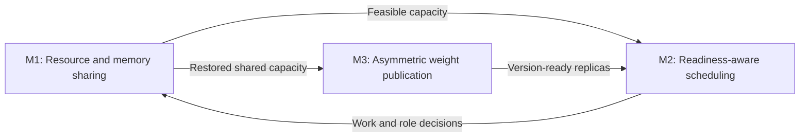

# Three core mechanisms

Organize the research around three mechanisms, not a flat list of independent
contributions. Preserve R001–R030 as implementation, experiment and decision records.

| Mechanism                                                                                     | Question                                                                                                                           | Records                                                                                         |
| --------------------------------------------------------------------------------------------- | ---------------------------------------------------------------------------------------------------------------------------------- | ----------------------------------------------------------------------------------------------- |
| [M1: Training-priority resource and memory sharing](mechanisms/M1-resource-memory-sharing.md) | When to borrow devices, how to handle memory pressure, and how to return capacity safely to training.                              | R007, R002, R006, R017, R014, R015, R018, R030                                                  |
| [M2: Request scheduling for training readiness](mechanisms/M2-readiness-aware-scheduling.md)  | Predict remaining work and choose draining, queued relocation or running migration to make training ready sooner.                  | R004, R019, R001, R005, R012, R013, R025 (capacity prototype), R026 (proposal), R027 (proposal) |
| [M3: Asymmetric asynchronous weight publication](mechanisms/M3-asymmetric-publication.md)     | Resume ready inference replicas promptly without blocking the whole training loop on shared-replica snapshot and restoration work. | R003, R008, R009, R010, R011                                                                    |

M1 determines safe capacity; M2 decides request placement and training readiness; M3
determines when replicas can use the next weight version. Together they target the
training-loop critical path.

## Supporting work, not extra core mechanisms

- R016: execution-path warmup, applied consistently to both comparison arms.
- R021/R022: backend and topology extensions; applicability is not a scaling claim.
- R023: observation, benchmarks, reuse tooling and reproducibility infrastructure.
- R024: upstream AReaL asynchronous context, not a new contribution.
- R020: negative TP2 tail experiment, retained as an M2 alternative.

## Preserve failed and non-beneficial investigations

Retain every historical record and evidence. Record hypothesis, implementation identity,
tested scope, outcome category, reproduction, interpretation and limitations.
Distinguish no benefit, regression, unvalidated proposals, mechanisms that never fired,
and engineering failures. A negative result in one configuration does not prove
universal ineffectiveness.

Reference these records in the corresponding mechanism and in ablation/discussion
sections to reduce repeated trial and error. The R001 timing gate, R019 sibling scaling
and R020 TP2 tails are useful counterexamples.

## Evidence status

The recent independently initialized comparison reduced total shared training-loop time
by 14.72%; this does not isolate the three mechanisms. See the
[accepted policy](experiments/2026-10-19-r001-accepted-policy.md). Novelty requires
related-work comparison; isolated benefit requires matched ablations and repeated
experiments.

R028 is a proposed cross-node extension of all three mechanisms; see
[the research plan](optimizations/R028-multinode-training-inference-sharing.md).

R029 extends M2 to reward-service scheduling and complete-question readiness. See
[R029](optimizations/R029-training-ready-reward-scheduling.md). No fourth core mechanism
is introduced.

R030 extends M1 to borrow idle inference devices for training. Its checkpoint-backed
baseline regressed; see [R030](optimizations/R030-idle-inference-training-expansion.md).
