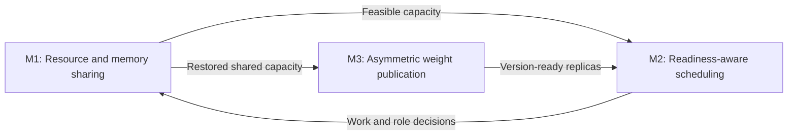

# 三个核心机制

以三个核心机制组织研究，而不是把 全部研究记录并列为独立贡献。R001–R030 保留为实现、实验与决策档案。

| Mechanism                                                                        | Question                                                                   | Records                                                                          |
| -------------------------------------------------------------------------------- | -------------------------------------------------------------------------- | -------------------------------------------------------------------------------- |
| [M1: 训练优先的资源与显存共享](mechanisms/M1-resource-memory-sharing.zh.md)      | 什么时候借卡、显存不够怎么办，以及如何安全交还训练。                       | R007, R002, R006, R017, R014, R015, R018, R030                                   |
| [M2: 面向训练就绪时间的请求调度](mechanisms/M2-readiness-aware-scheduling.zh.md) | 预测剩余工作，在排空、排队搬移和运行中迁移之间选择，尽早满足训练启动条件。 | R004, R019, R001, R005, R012, R013, R025（容量原型）, R026（提议）, R027（提议） |
| [M3: 非对称异步权重发布](mechanisms/M3-asymmetric-publication.zh.md)             | 让已就绪的推理卡尽早恢复，避免共享卡快照和恢复工作阻塞整个训练循环。       | R003, R008, R009, R010, R011                                                     |

M1 决定资源能否安全使用；M2 决定何时、在哪张卡执行请求及开始训练；M3 决定新权重何时可以被各推理副本使用。三个机制共同服务于缩短训练循环关键路径。

## 配套工作，不另算核心机制

- R016：真实执行路径预热，属于公共执行支持，两组应保持一致。
- R021、R022：后端适配及多卡扩展，说明适用范围，不自动产生扩展收益结论。
- R023：观测、benchmark、复用工具和可复现方法，单独归为实验基础设施。
- R024：AReaL 上游异步背景，不算本项目新增贡献。
- R020：TP2 长尾负面实验，作为 M2 的替代方案分析保存。

## 保留失败、无收益与未采用方案

所有历史记录和证据保留，不因结果不理想而删除。每项应注明：假设、实现版本、测试范围、结果类别、可复现实验、解释及适用边界。区分已实现但无收益、观察到退化、尚未验证、未触发机制和工程故障。不能把单一配置中的负面结果推广成普遍无效。

论文可在相应机制小节和消融/讨论章节引用这些记录，帮助后来者避免重复试错。R001 时机判断、R019 同题缩放、R020 TP2 长尾等是重要反例。

## 证据状态

最近独立启动对照共享整体耗时降低
14.72%，不代表三个机制各自的收益已确认。参见[已认可策略](experiments/2026-10-19-r001-accepted-policy.zh.md)。创新性还需相关工作对照，独立贡献还需匹配消融与重复实验。

R028
是三个机制的跨节点扩展提议，见[研究计划](optimizations/R028-multinode-training-inference-sharing.zh.md)。

R029将M2扩展至评分服务调度和完整题目就绪，见[R029](optimizations/R029-training-ready-reward-scheduling.zh.md)，不新增第四个核心机制。

R030将M1扩展为借用空闲推理卡参与训练；检查点基线为负收益，见[R030](optimizations/R030-idle-inference-training-expansion.zh.md)。
