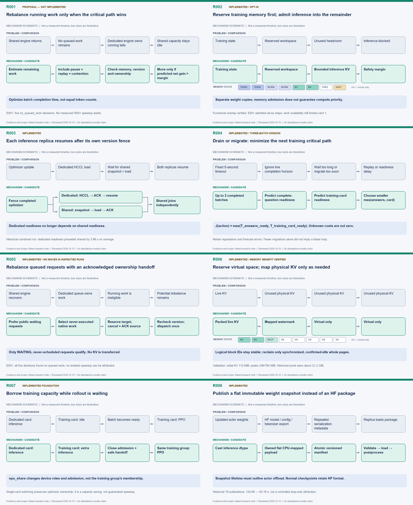
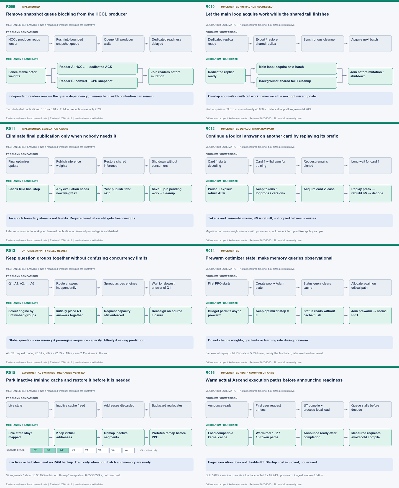
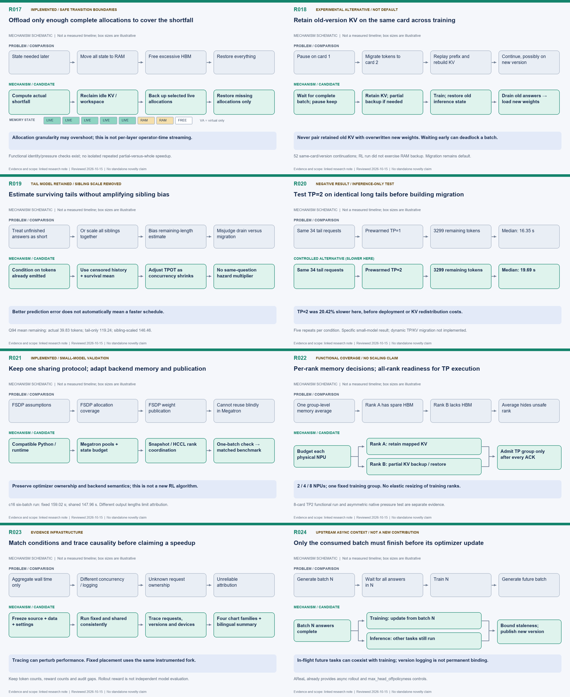

# Research mechanism atlas

[English](diagrams.md) | [中文](diagrams.zh.md)

These are mechanism schematics, not measured timelines. Box sizes do not encode elapsed
time or memory. English artwork is shared by both language editions. Proposed, negative
and upstream-context entries are explicitly labelled.

[HTML gallery](diagrams.html)

## Contact sheets







## Individual diagrams

### R001 · Rebalance running work only when the critical path wins

Optimize batch completion time, not equal token counts.

[Note](optimizations/R001-runtime-request-rebalancing.md) |
[PNG](optimizations/R001.png) | [SVG](optimizations/R001.svg)

### R002 · Reserve training memory first; admit inference into the remainder

Separate weight copies; memory admission does not guarantee compute priority.

[Note](optimizations/R002-training-priority-concurrency.md) |
[PNG](optimizations/R002.png) | [SVG](optimizations/R002.svg)

### R003 · Each inference replica resumes after its own version fence

Dedicated readiness no longer depends on shared readiness.

[Note](optimizations/R003-asymmetric-publication.md) | [PNG](optimizations/R003.png) |
[SVG](optimizations/R003.svg)

### R004 · Drain or migrate: minimize the next training critical path

J(action) = max(T_answers_ready, T_training_card_ready). Unknown costs are not zero.

[Note](optimizations/R004-adaptive-draining.md) | [PNG](optimizations/R004.png) |
[SVG](optimizations/R004.svg)

### R005 · Rebalance queued requests with an acknowledged ownership handoff

Only WAITING, never-scheduled requests qualify. No KV is transferred.

[Note](optimizations/R005-queued-request-rebalancing.md) | [PNG](optimizations/R005.png)
| [SVG](optimizations/R005.svg)

### R006 · Reserve virtual space; map physical KV only as needed

Logical block IDs stay stable; reclaim only synchronized, confirmed-idle whole pages.

[Note](optimizations/R006-dynamic-kv-pages.md) | [PNG](optimizations/R006.png) |
[SVG](optimizations/R006.svg)

### R007 · Borrow training capacity while rollout is waiting

npu_share changes device roles and admission, not the training group's membership.

[Note](optimizations/R007-single-npu-and-borrowing.md) | [PNG](optimizations/R007.png) |
[SVG](optimizations/R007.svg)

### R008 · Publish a flat immutable weight snapshot instead of an HF package

Snapshot lifetime must outlive actor offload. Normal checkpoints retain HF format.

[Note](optimizations/R008-flat-weight-snapshots.md) | [PNG](optimizations/R008.png) |
[SVG](optimizations/R008.svg)

### R009 · Remove snapshot queue blocking from the HCCL producer

Independent readers remove the queue dependency; memory bandwidth contention can remain.

[Note](optimizations/R009-independent-snapshot-reader.md) |
[PNG](optimizations/R009.png) | [SVG](optimizations/R009.svg)

### R010 · Let the main loop acquire work while the shared tail finishes

Overlap acquisition with tail work; never race the next optimizer update.

[Note](optimizations/R010-background-step-tail.md) | [PNG](optimizations/R010.png) |
[SVG](optimizations/R010.svg)

### R011 · Eliminate final publication only when nobody needs it

An epoch boundary alone is not finality. Required evaluation still gets fresh weights.

[Note](optimizations/R011-terminal-publication-elision.md) |
[PNG](optimizations/R011.png) | [SVG](optimizations/R011.svg)

### R012 · Continue a logical answer on another card by replaying its prefix

Tokens and ownership move; KV is rebuilt, not copied between devices.

[Note](optimizations/R012-request-leases-and-migration.md) |
[PNG](optimizations/R012.png) | [SVG](optimizations/R012.svg)

### R013 · Keep question groups together without confusing concurrency limits

Global question concurrency ≠ per-engine sequence capacity. Affinity ≠ sibling
prediction.

[Note](optimizations/R013-question-affinity-and-concurrency.md) |
[PNG](optimizations/R013.png) | [SVG](optimizations/R013.svg)

### R014 · Prewarm optimizer state; make memory queries observational

Do not change weights, gradients or learning rate during prewarm.

[Note](optimizations/R014-optimizer-prewarm-and-pure-status.md) |
[PNG](optimizations/R014.png) | [SVG](optimizations/R014.svg)

### R015 · Park inactive training cache and restore it before it is needed

Inactive cache bytes need no RAM backup. Train only when both batch and memory are
ready.

[Note](optimizations/R015-training-cache-parking-prefetch.md) |
[PNG](optimizations/R015.png) | [SVG](optimizations/R015.svg)

### R016 · Warm actual Ascend execution paths before announcing readiness

Eager execution does not disable JIT. Startup cost is moved, not erased.

[Note](optimizations/R016-ascend-kernel-warmup.md) | [PNG](optimizations/R016.png) |
[SVG](optimizations/R016.svg)

### R017 · Offload only enough complete allocations to cover the shortfall

Allocation granularity may overshoot; this is not per-layer operator-time streaming.

[Note](optimizations/R017-pressure-driven-partial-offload.md) |
[PNG](optimizations/R017.png) | [SVG](optimizations/R017.svg)

### R018 · Retain old-version KV on the same card across training

Never pair retained old KV with overwritten new weights. Waiting early can deadlock a
batch.

[Note](optimizations/R018-retained-pause.md) | [PNG](optimizations/R018.png) |
[SVG](optimizations/R018.svg)

### R019 · Estimate surviving tails without amplifying sibling bias

Better prediction error does not automatically mean a faster schedule.

[Note](optimizations/R019-tail-estimation-and-sibling-ablation.md) |
[PNG](optimizations/R019.png) | [SVG](optimizations/R019.svg)

### R020 · Test TP=2 on identical long tails before building migration

TP=2 was 20.42% slower here, before deployment or KV redistribution costs.

[Note](optimizations/R020-tp-tail-negative-result.md) | [PNG](optimizations/R020.png) |
[SVG](optimizations/R020.svg)

### R021 · Keep one sharing protocol; adapt backend memory and publication

Preserve optimizer ownership and backend semantics; this is not a new RL algorithm.

[Note](optimizations/R021-megatron-backend-adaptation.md) |
[PNG](optimizations/R021.png) | [SVG](optimizations/R021.svg)

### R022 · Per-rank memory decisions; all-rank readiness for TP execution

2 / 4 / 8 NPUs; one fixed training group. No elastic resizing of training ranks.

[Note](optimizations/R022-multi-npu-rank-budgets.md) | [PNG](optimizations/R022.png) |
[SVG](optimizations/R022.svg)

### R023 · Match conditions and trace causality before claiming a speedup

Tracing can perturb performance. Fixed placement uses the same instrumented fork.

[Note](optimizations/R023-observability-and-reproducibility.md) |
[PNG](optimizations/R023.png) | [SVG](optimizations/R023.svg)

### R024 · Only the consumed batch must finish before its optimizer update

In-flight future tasks can coexist with training; version logging is not permanent
binding.

[Note](optimizations/R024-async-and-multiversion-context.md) |
[PNG](optimizations/R024.png) | [SVG](optimizations/R024.svg)

## Regeneration

```bash
python optimizations/generate_diagrams.py --font-dir /path/to/truetype/fonts
```

The generator reads `optimizations/diagram_specs.json`. SVG needs only Python standard
library; PNG/contact sheets additionally require an existing Pillow installation and
TrueType fonts.
