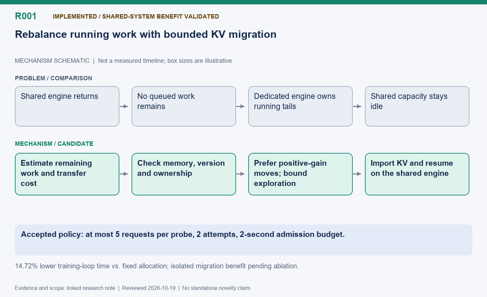

[English](R001-runtime-request-rebalancing.md) | 中文

当前状态：已实现，共享系统整体收益已验证。独立启动对照中，训练循环耗时比固定双卡低 14.72%。运行中请求 KV 迁移的独立贡献，仍需在相同共享策略下进行开关消融实验确认。

> Current accepted policy and results:
> [2026-10-19](../experiments/2026-10-19-r001-accepted-policy.zh.md). Earlier sections
> below record historical stages.

# R001：成本感知的运行中请求再均衡

建立日期：2026-10-15；更新日期：2026-10-16（America/Vancouver）。状态：实验性实现，已验证真实 KV 续跑及 RL 路由；六批、16/32
题并发对照尚未证明迁移带来额外收益。不宣称创新性。

## 机制示意图

**读图：**
共享卡恢复后，先估算运行中请求的剩余时间，把暂停、重放、资源争用全部计入成本；只有关键路径净收益为正且约束满足才迁移。当前为实验性实现，功能已验证，性能收益尚未证实。

此图仅表达机制，不按时间或显存大小绘制；状态和结果边界以本文为准。

[SVG](R001.svg) | [PNG](R001.png)

## 动机与证据

[E001](../experiments/20261015-144720-megatron-c32-b6.zh.md) 中，共享卡只生成了 21.3% 的
token，五次恢复后的排队请求再均衡均返回 `no_queued_work`。 当前 R005
有意排除已经开始执行的请求。因此，源引擎仍有大量工作时，也可能没有符合再均衡条件的请求。

## 假设

当预计剩余工作超过迁移、重建和计算竞争的成本时，将部分长请求从专用推理引擎转给共享引擎，可能缩短关键批次完成时间。 目标是降低整个 RL 循环耗时并保持正确性，不是让两卡
token 数相等。

## 候选决策公式

对候选请求集合 S：

`收益(S) = 不迁移时的预计关键完成时间 - 迁移后的预计关键完成时间`

后一项必须包含源端中断、传输或提示词/KV 重放、目标端剩余解码、对其他请求的影响以及训练变慢。 只有预计收益超过不确定性余量，且显存与版本约束满足时才执行。
服务速率与剩余长度使用现有滑动窗口估计：最多取此前三个已完成批次，启动阶段不足三个时用已有数据；不得使用未来观测。 具体估计器和回退行为仍需设计。

## 正确性约束

- 优先保障训练显存，接收请求时重新检查目标空间。
- 保持请求身份、已生成前缀、采样和终止语义以及兼容的权重版本；不能无声地用新权重继续旧前缀。
- 明确迁移究竟传输 KV 还是重建 KV，不能假设已有免费 KV 传输；记录实际路径和成本。
- 保证同一请求最多一个执行所有者、不丢失回答、重试有界。
- 加入迟滞或冷却机制，避免来回迁移。
- 成本、版本或内存检查无效时拒绝迁移。

## 实现与验证计划

1. 先只记录候选快照和两种选择的预测，不实际迁移。
1. 小实验检查所有权交接、前缀与版本完整性、失败恢复。
1. 实现可选策略，保留现有仅排队请求的基线。
1. 对比固定双卡、共享仅排队再均衡、共享排队加运行中再均衡。
1. 模型、数据、配置、日志一致，配对多个种子重复实验。隔离执行开销时使用同输入回放；实时采样可能产生不同回答。
1. 测量循环及批次耗时、吞吐、TTFT/TPOT/latency、训练变慢、迁移 token/字节、重放成本、预测误差、显存压力及奖励和质量。
1. 覆盖长短尾、显存不足、即将发布权重以及不迁移反而更好的情形；报告退化和波动，不只报告最好结果。

## 相关工作与结论

相关工作检索：待做。实现 commit：无。实验结果：无。 后续在此关联实验编号，保留负面发现和假设修订。

## 建议代码落点与论文定位

预计涉及
`areal/infra/queue_rebalance.py`（候选与成本模型）、`request_router.py`（租约和目标容量）、`areal/engine/vllm_ext/queue_rebalance.py`（引擎内安全中断）、`rollout_controller.py`（版本和恢复时机）。这些是计划落点，不代表已实现。

现有迁移通常通过前缀重放，而不是直接传 KV。R001
必须选择版本兼容的目标并明确重放成本；不能把已有反方向迁移简单翻转就称为同版本迁移。困难在于运行中请求所有权、已生成内容、取消确认、模型版本和训练计算竞争同时变化。

可研究的核心是“在未来训练约束下，仅当迁移的预计关键路径收益大于全部成本时才再均衡”。相对通用任务窃取或推理迁移的新颖性需要文献比较。当前没有实现收益；E001 的 9.37%
属于原组合策略，不属于 R001。

参阅
[R005 排队再均衡](../optimizations/R005-queued-request-rebalancing.zh.md)、[R012 跨卡续写](../optimizations/R012-request-leases-and-migration.zh.md)、[R019 预测局限](../optimizations/R019-tail-estimation-and-sibling-ablation.zh.md)。

## 实现更新（2026-10-15）

已加入实验性实现，通过 `--running-rebalance off|shadow|active` 控制；默认关闭， 固定组始终关闭。`shadow`
只记录预测，`active` 才尝试迁移已经开始执行的请求。 采用中断后重放已生成前缀、重建 KV 的方式，并非直接传输 KV。

每次最多选择一个请求，同一个逻辑请求最多参与一次主动再均衡。源请求完整返回前 不释放执行权；交接期间保护源和目标的权重版本；目标拒绝后重试仍保留版本约束，
最多尝试三次。没有兼容版本或执行状态不明确时停止，而不是悄悄换版本继续。 同时检查当前阶段的推理预算、KV 空间及训练是否已经就绪。10 秒交接看门狗只用于检测
故障，不是排空策略的性能参数。

核心位置是 `areal/infra/running_rebalance.py`、`queue_rebalance.py`、
`request_router.py`、`rollout_controller.py` 及 vLLM 的再均衡接口。 分析脚本
`benchmark/npu_share/analyze_running_rebalance.py` 汇总预测并检查执行权 重叠和交接版本。真实 vLLM
契约测试覆盖运行中取消、累计 token 和 logprob 保留。

当前公式预测整个活跃请求集合的尾部完成时间；它尚未准确预测下一次训练撤回时刻， 也未完成训练争用不确定性的标定。实现存在不等于已证明有加速收益，实测结果需另行
记录。同版本交接也不代表整个 RL 回答永远使用同一权重版本。

为分离预算与迁移的收益，另提供 `--running-rebalance budget`：建立与 `active` 相同的纯推理 KV
预算并记录预测，但不迁移运行中请求。`off` 和只读 `shadow` 不建立这个新预算。因此 `active` 对比 `off` 只能说明组合改动的效果；要单独评价
运行中迁移，应比较 `budget` 与 `active` 并进行多次重复实验。

## 初次实机发现（2026-10-15）

两次三批实验均完成，请求归属审计没有发现重叠，但运行中请求迁移次数均为零。 shadow 的两次判断均因未预留训练显存而跳过；首次 active 的两次判断也被拦截，
早先怀疑训练权重卸载，但详细日志已推翻该判断：训练权重和优化器仍驻留。

修正后的预留额加入训练权重恢复字节和已解除映射的工作区字节，仍保留优化器、 梯度、权重发布、训练/推理工作区及安全余量。此操作只预留未来恢复空间， 不提前恢复训练模型，也不放松
PPO 期间原有的驻留要求。修正后的实机验证需 单独记录，不能把零迁移的完整运行当成迁移端到端验证成功。

shadow 的固定/共享训练循环为 102.026/89.815 秒；首次 active 为 100.917/114.981 秒，生成 token 分别为
68,839/67,390。这些单次结果尚不能证明 R001 收益，特别是实际迁移次数为零。
证据：[初次验证](../experiments/evidence/r001-initial-validation/)。

### 后续预算诊断与更正

实验 `20261015-230757-0700_math_fsdp_c16_b3_77def7` 三批均完成，固定/共享 耗时为 104.790/88.361 秒，生成
token 为 67,501/68,239。两次恢复仍拒绝迁移， 请求归属违规与未释放租约均为零。由于运行中迁移次数为零，不能把共享组快 15.68% 归为 R001 收益。

第一次恢复时空闲显存为 18,239,004,672 字节，要求预留增长为 27,649,693,696 字节，故 KV 预算为零。动态 KV 已启用，训练权重恢复字节为零。
增加恢复显存预留只是兼容卸载场景的防护，并没有修复这次实际出现的拒绝原因。 保留的训练工作区是否与预算增长量重叠，需要分配器层面的证据；不能直接抵扣
缓存或降低安全预留。运行中请求迁移的实机端到端验证和因果性能收益均未完成。

证据已保存为 `active-reserved-restore.json`、对应 summary 和 `budget-rejection.log`。

## 按阶段划分预算的修正（2026-10-15）

共享卡恢复纯推理时预留下一轮训练显存，不符合本实验的切换策略。现改为只 保留推理工作区及安全余量，不预留未来训练权重恢复、优化器、梯度或训练工作区。
现有提前恢复逻辑在批次接近收齐时关闭推理入口，处理在途请求，回收推理显存， 再恢复训练状态。真正训练与推理重叠时仍调用 concurrent_train()。

budget 与 active 两种模式均使用 inference_budget()，以便同条件对照。 保留每卡预算、TP 最小容量、实际接收续写时的预算及完整上下文容量检查。
不会无条件把训练显存全部卸载：沿用按压力回收策略，空间足够时仍保留驻留。 前一版恢复显存预留实现已移除，上文负面结果保留作为策略修正的证据。

### 纯推理预算验证（2026-10-16）

实验 `20261015-235533-0700_math_fsdp_c16_b3_795d4f` 固定/共享各三批均完成， 耗时 100.868/94.355 秒，生成
token 为 68,403/66,134。两次恢复的预算均通过， 只为推理工作区及安全余量预留 4 GiB，KV 额度分别为 14,686,363,648 和
14,795,333,632 字节（有效容量均为 4,000 blocks）。原训练预留拦截已消除。

两次决策均为 no_predicted_gain：源卡分别有 48、6 个运行中请求，目标卡没有 运行中请求，两卡均无排队请求。实际迁移次数为零，归属违规和未释放租约均为零。
共享组快 6.46% 不能作为 R001 迁移收益证据，生成 token 总数也不同。实际运行中 迁移目前只有契约/单元测试覆盖，本轮实机并未触发。

195 项回归测试通过，覆盖各卡预算失败清理以及训练权重卸载时的推理准入。证据 保存为
inference-budget.json、inference-budget-summary.md、inference-budget.log。

## KV 传输与批量方案原型（2026-10-16）

两张 NPU 上使用 BF16 Qwen2.5-1.5B 真实模型，将单请求 KV 经 HCCL 传输。 64、256、1024 个已计算 token 对应 1.75、7、28
MiB；传输后 KV 逐元素一致， 保留最后一个已采样但尚未计算 KV 的 token 后，两端接着生成的 16 个贪心 token
也完全一致。预热后打包、传输及恢复合计中位数为 3.927、4.173、4.102 ms； 同一 Transformers eager 探针中的前缀重算为
63.267、69.421、133.491 ms。 这不是 vLLM 重算性能，也不包含暂停、block 导入和版本交接成本。每个长度五次
传输，排除首次后取四次中位数，未测试与训练或权重发布争用。

新增传输原语 `areal/engine/kv_transfer.py`、实机探针
`benchmark/npu_share/kv_transfer_probe.py`、只出方案不执行的批量调度器
`areal/infra/batch_rebalance.py`，以及历史快照回放脚本
`benchmark/npu_share/replay_batch_rebalance.py`。调度器扫描一次快照，比较 重算与 KV
成本，尝试若干有序候选子集，并检查容量、版本与方案计算开销。 未知的接管成本使用显式敏感性参数，execution_ready 始终为 false。

48 请求快照中，批量迁移 16 个请求的重算方案预测提前 0.155 秒；扣除约 0.087 秒计算开销，只剩约 0.069 秒。额外接管成本为零的 KV 方案也选 16
个， 尾部预测几乎相同。接管成本增加 50 ms 时，候选变为 10 个，但原始收益只有 0.023 秒，小于计算开销，因此拒绝。六请求快照没有预测收益。这些均是模型
推算，不是实测加速；旧快照中的 KV 布局与 64-token block 舍入也是显式假设。

尚未完成的 vLLM 链路包括：冻结并排空在途执行、目标 block 分配、首次调度前 导入稀疏页面归属、恢复准确已计算 token 数，以及目标确认后才释放源请求。 现有
slab 路径不支持直接启用标准 kv_transfer_config，不能直接接上标准 connector。 当前没有启用运行中 KV 接管。

[原始证据](../experiments/evidence/r001-kv-prototype-20261016/summary.json)。

### 复核后的成本核算

以 `batch-replay-reviewed.json` 为复核结果；较早的回放文件仅为初步结果。修订模型把串行 KV 传输期间的暂停计入两端引擎，补计尚未计算的
prefill token，并保留迁移顺序。在 48 请求快照中，仅重放方案选择 16 个请求，预测尾部耗时从 11.576 秒降至 11.421 秒；扣除实测 0.103
秒规划成本，净预测收益仅 0.052 秒。加入 KV 候选没有进一步降低所选方案的尾部耗时；接管开销设为 0/50 毫秒时，规划约耗时 0.173 秒，方案因此被拒绝。剩余 6
请求的快照仍不迁移。这些是预测，并非实际 RL 加速。规划时间受主机负载影响。当前保守的整引擎暂停假设可能抵消廉价 KV
传输的优势；请求级接管协议尚未实现。最终定向回归测试通过 83 项。

### 在线 KV 交接实验

实验开关为
`--running-rebalance kv`，只作用于共享组。保留已有排队请求再均衡，然后仅在目标卡已获得推理显存预算、训练尚不紧迫且权重版本一致时考虑运行中的请求。使用因果批次窗口预测，对至多
16 个请求的候选组合与原地完成进行比较。完整交接成本初始按每请求 100 毫秒估计，后续实测可提高该估计；扣除规划成本后，预测收益还须超过 250
毫秒与两倍交接成本中的较大者。这些初始保守阈值尚需在线数据校准。

源端只停止调度选中的请求，保留其调度名额与 KV 所有权；其已发出的计算结束后，打包为不再修改的 KV 数据。使用独立、预热的 HCCL
通信组发送到目标暂存区。一次性票据绑定续写请求、完整 token 前缀摘要、准确已计算长度、KV 布局与路由权重版本。目标确认收到后，源端通过既有中止响应返回累计
token/logprob；目标实际接收续写时分配自有块，导入 KV，并正常计算尚未完成的 token。稀疏页在目标 worker 接管前保持映射，取消请求也释放其固定关系。

初版限于两个 TP=1 的 Qwen2 全注意力实例，使用动态
KV、eager，关闭前缀缓存和推测解码；采样不指定请求级随机种子、不使用惩罚、最短输出限制或字符串停止条件。分布式交接状态不确定时停止实验，避免重复执行。本功能默认关闭。不能声称对所有其他场景都没有负收益：预测和通信本身有成本，预测也可能失准。验收包括
token/logprob 正确性、同条件性能对照、实际正收益场景，以及不应迁移时的回归场景。

在线正确性验证已通过：源端生成 34 个 token 后，目标端实际导入 91 个已计算 token 的 KV；最终 256 个输出 token
与不中断的贪心生成完全一致，logprob 最大误差为 0.0。源端打包 3.5 MiB 用时 11.57 毫秒，两端分别测得 HCCL 传输 5.07/1.84
毫秒。这些分项时间不等于完整交接耗时。证据：`../experiments/evidence/r001-kv-live-20261016/correctness.json`。Ascend
会在运行时替换调度器类，因此冻结钩子必须安装到实际调度器类；已增加覆盖此行为的回归测试。

### 在线调度的保守收益门槛（2026-10-16 后续修正）

在线适配器仅评估实际可执行的 KV 迁移，并要求取得原生调度器的准确已计算 token 数。
当前传输协议先暂存全部所选请求，随后统一终止源端执行，因此预测将整组迁移等待计入两卡， 包括未迁移请求，避免假设先传完的请求可以提前恢复、或工作进程 RPC 不占用执行时间。
这是保守近似，并不是数学意义上的无回退保证。

每次导出前及源端统一终止前，重新检查训练是否即将开始。如果训练已准备好，则丢弃目标暂存票据、 解除源请求冻结、取消路由预留。预测要求请求属于原生 running 或
waiting 集合，不能把路由层的 active 数直接当作同时解码数。新增快照日志保存预测输入，保留具体拒绝原因，便于审计。

新增平坦解码性能测试：仅仅让两卡请求数更均匀不能授权迁移，必须扣除成本后能改善完成时间。 这些保护措施本身不证明新增性能收益。首次 6 批、16 题并发诊断没有发生实际 KV
迁移， 因此其中固定与共享的耗时差异不能归因于本功能。

### 不重复采样地处理接收与完成的时间差

16 题并发的在线快照暴露了路由登记与原生执行状态之间的正常时间差：新请求已经取得路由租约，
但尚未进入引擎；已经完成的请求仍在等待路由释放回调。原来遇到其中任意一种情况就放弃整次规划。

修正后，尚未接收的请求作为等待工作计入预测，包含其预填充及后续生成成本，保留其目标卡容量， 但绝不选择它进行 KV 迁移。对于已完成请求，只有历史中的请求 ID
和当前完整输入长度 （原始输入加已保留的回答前缀）匹配，才排除该已结束尝试。更短的旧尝试不能证明当前续跑已结束。
对于仍活跃但原生状态不明确的请求，依然拒绝该快照。没有增加第二轮 RPC，也没有锁住整个路由接收过程。

用修正代码回放本次保存的五次恢复快照后，五次均完成了预测，但仍然均选择零迁移。 这是快照处理的离线验证，并不是实测调度加速。

本次六批在线对照及其局限见
[2026-10-16 实验报告](../experiments/2026-10-16-r001-live-kv-scheduling.zh.md)。

## 同 TP 宽度的 KV 迁移扩展（2026-10-19）

R001 已扩展为两个相同 TP 宽度、PP=1 的推理实例之间按分片对应迁移。 每个 rank 使用独立的 HCCL 对端通道，所有 rank 都通过分配预检查并确认导入后
才能恢复请求；不兼容的分片布局会被拒绝。成本模型汇总各分片传输字节数， 实例阻塞时间采用最慢 rank 的时间。四张 NPU 的 TP=2 探针验证中，256 个贪心 输出
token 完全一致，最大 log-probability 误差为零；导出前生成了 34 个 token， 导入了 91 个已计算 token。这验证迁移及续推正确性，不代表
RL 性能收益。 TP=4 尚待硬件验证，任意多实例之间的配对调度仍未实现。

详见 [TP=2 验证记录](../experiments/2026-10-19-r001-tp2.zh.md)。

## 多个同 TP 实例扩展（2026-10-19）

现在每条“固定推理实例 → 共享推理实例”有独立的 HCCL 通道，每个 TP rank 分别传输。按实例对保存几何信息并检查发送/接收角色，避免多个对端覆盖同一个通道。
恢复调度串行扫描实例对，每次迁移后重新采集状态；训练切换等待整个扫描结束。 探索次数和耗时预算仍为整个 controller 共用，不随实例数扩大。
当前采用确定性贪心顺序，不宣称是全局最优分配。

8 张 NPU、4 个 TP=2 实例的探针覆盖全部 4 条固定到共享通道。 全部返回 `import_applied`，256 个输出 token 完全一致，最大
logprob 误差为 0。 见[实验证据](../experiments/2026-10-19-r001-multipeer-probe.json)。
这说明多对端传输及续算正确，不代表已经验证性能收益。 TP=4 尚未实机验证；任意双向迁移不在本次支持范围内。

Megatron 集成验证使用 4 张 NPU、4 个 TP=1 推理实例，完成 3 批次（48 题、 每题 6 个回答、16 题并发）。两个固定实例分别向同一共享实例迁移 5
个请求， 10 个独立 ticket 均确认 `import_applied`。训练循环耗时 78.74 秒。
本次没有固定组对照，不能据此宣称性能收益。第二个共享目标在本次负载中未被选中； 全部 4 条通道已由独立 TP=2
探针验证。见[集成验证记录](../experiments/2026-10-19-r001-multipeer-smoke.json)。
