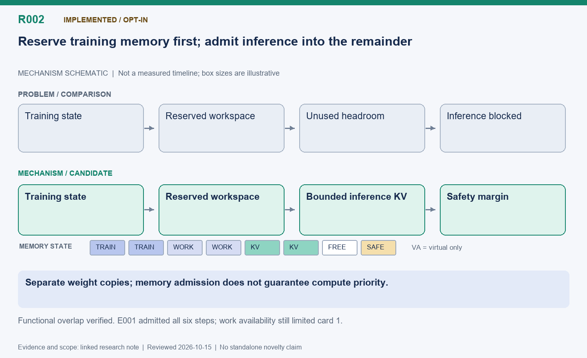

[English](R002-training-priority-concurrency.md) | 中文

# R002: 训练显存优先的同卡训练与推理重叠

状态：已实现，可选开启；实际重叠已验证，独立性能收益仍取决于负载。

整理日期：2026-10-15（America/Vancouver）。本页按历史证据整理，不代表重新实测。

## 机制示意图

**读图：** 先为训练状态、工作区和安全余量保留显存，再将剩余预算用于推理 KV。训练与推理保留独立权重，允许重叠不代表一定有请求可运行，也不保证计算不争用。

此图仅表达机制，不按时间或显存大小绘制；状态和结果边界以本文为准。

[SVG](R002.svg) | [PNG](R002.png)

## 问题与主要思路

纯时间切分会让推理在整个 PPO 阶段停下来，即使显存足够容纳两者。先为训练状态、待分配的梯度和优化器、训练及推理工作区、安全余量预留空间，再把剩余预算交给推理
KV；同时限制物理页和调度器可用块编号。两个进程各自保留模型权重，并发执行不等于一边修改同一份权重一边推理。

## 优化点、候选贡献与难点

候选贡献是把训练显存预留与实时推理准入联动，而不只是让两个进程共用设备。空间不足时回退时间切分；发布权重前关闭准入并确认暂停，再修改推理权重或解除容量限制。难点是显存安全不等于计算优先：算子、CPU
和带宽竞争仍可能拖慢 PPO。当前工作区预算不是任意算子缺页式调度，也不能保证所有负载都不 OOM。

## 实测收益与边界

Code RL 验证中，原迁移共享为 211.09 秒，新方案为 200.83 秒，约缩短 4.9%，但并非相同生成回答回放。算术实验固定组 169.43 秒、134766
token，共享组 157.84 秒、137139 token，约缩短 6.84%；这是组合系统结果，不能单独归给本项。E001 六批均允许重叠，但卡 1 只生成 21.3%
的 token，说明放行推理不等于实际有任务。

## 下一步验证

保持 KV 策略一致做重叠开关消融，使用相同生成输入衡量 PPO 竞争。统计实际设备执行窗口交集，而不是只统计允许重叠事件；同时观察延迟、奖励和显存压力。

## 代码位置

- [areal/trainer/rl_trainer.py](../../../../areal/trainer/rl_trainer.py)

- [areal/trainer/colocation_memory.py](../../../../areal/trainer/colocation_memory.py)

- [areal/engine/vllm_ext/dynamic_kv.py](../../../../areal/engine/vllm_ext/dynamic_kv.py)

- [areal/engine/vllm_ext/kv_slab_adapter.py](../../../../areal/engine/vllm_ext/kv_slab_adapter.py)

## 实验证据与会话来源

- [training-priority02/validation.json](../experiments/evidence/history/training-priority02/validation.json)

- [math-training-priority01/comparison.json](../experiments/evidence/history/math-training-priority01/comparison.json)

会话摘录编号：C099. [查看摘录](../experiments/evidence/conversation-excerpts.json)

原始证据根目录：`/root/areal-research-artifacts/history-20261015/`. 这是选择性归档，未包含模型检查点和完整 profiler
大文件；并非完整可运行备份。

## 论文表述约束

本页所说的“候选贡献”仅表示值得研究的机制，没有完成系统相关工作检索，不能据此声称首次提出。单次实时 RL
的回答长度、消费顺序和训练轨迹可能变化；不同实验的百分比不能相加。未单独消融的收益只能归于组合方案。
