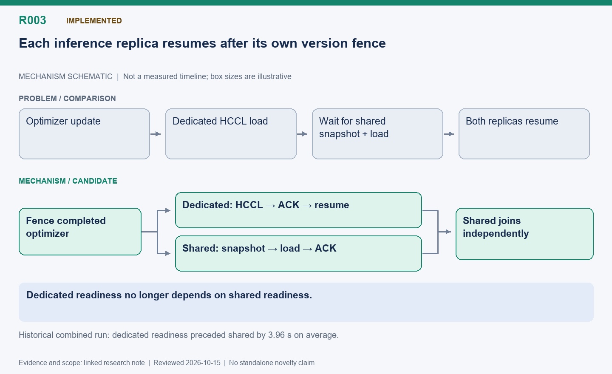

[English](R003-asymmetric-publication.md) | 中文

# R003: 专用推理卡与共享卡的非对称权重发布

状态：已实现；后续由 R009 和 R010 继续消除依赖。

整理日期：2026-10-15（America/Vancouver）。本页按历史证据整理，不代表重新实测。

## 机制示意图

**读图：** 固定推理卡完成自己的 HCCL 加载、确认版本后就恢复；共享卡独立等待快照加载完成再加入。图中两条发布路径逻辑独立，并非依次等待。

此图仅表达机制，不按时间或显存大小绘制；状态和结果边界以本文为准。

[SVG](R003.svg) | [PNG](R003.png)

## 问题与主要思路

若两份推理副本一起等到全部更新完，专用卡会被共享卡的内存切换和 CPU 快照加载拖住。训练卡通过 HCCL
发布给专用卡，该卡加载确认并提交版本后即可继续推理；共享卡则等待自己的快照加载和确认后再加入。HCCL 通信组包含训练进程和专用推理进程，不包括同卡推理进程。

## 优化点与难点

优化点是在所有副本尚未就绪时先释放可用推理能力，同时维持逐副本版本边界。KV slab 必须支持 HCCL
初始化与全权重加载，而不能靠禁用接口绕过问题。使用带版本的原子快照清单判断就绪。共享加载失败时保持该副本关闭并通知训练失败；已确认的专用卡权重仍有效。

## 实测收益与边界

历史 256 题、16 次更新实验中，同步快照共享为 426.58 秒，非对称发布为 389.89 秒，缩短 8.6%；训练到最后发布完成由 393.60 降到 356.99
秒，缩短 9.3%。专用卡平均 0.89 秒就绪，比共享卡早 3.96 秒，这些空档内完成了 150 次生成。但固定组训练到发布仍更快，为 340.56
秒。评估和回答长度不同，不能把完整循环差异全部归因于发布。

## 下一步验证

分别统计 HCCL 完成、快照导出、共享内存切换、加载和准入。历史版本仅单训练 rank 的限制，只有 R022 中明确验证过的多 rank 路径才算扩展，不能泛化到任意拓扑。

## 代码位置

- [areal/trainer/rl_trainer.py](../../../../areal/trainer/rl_trainer.py)

- [areal/engine/fsdp_engine.py](../../../../areal/engine/fsdp_engine.py)

- [areal/engine/weight_snapshot.py](../../../../areal/engine/weight_snapshot.py)

- [areal/infra/controller/rollout_controller.py](../../../../areal/infra/controller/rollout_controller.py)

## 实验证据与会话来源

- [npu-share-hybrid03/comparison.json](../experiments/evidence/history/npu-share-hybrid03/comparison.json)

- [npu-share-fast01/comparison.json](../experiments/evidence/history/npu-share-fast01/comparison.json)

会话摘录编号：C020. [查看摘录](../experiments/evidence/conversation-excerpts.json)

原始证据根目录：`/root/areal-research-artifacts/history-20261015/`. 这是选择性归档，未包含模型检查点和完整 profiler
大文件；并非完整可运行备份。

## 论文表述约束

本页所说的“候选贡献”仅表示值得研究的机制，没有完成系统相关工作检索，不能据此声称首次提出。单次实时 RL
的回答长度、消费顺序和训练轨迹可能变化；不同实验的百分比不能相加。未单独消融的收益只能归于组合方案。
