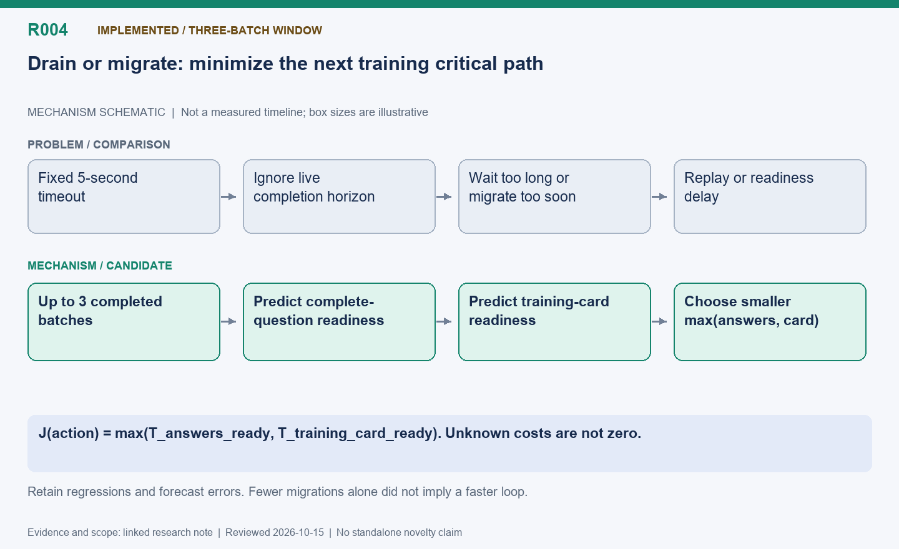

[English](R004-adaptive-draining.md) | 中文

# R004: 以训练就绪时间为目标的滑动窗口自适应排空

状态：已实现；保留三批窗口，移除了同题长度缩放。

整理日期：2026-10-15（America/Vancouver）。本页按历史证据整理，不代表重新实测。

## 机制示意图

**读图：** 从最多三个已完成批次建立滑动窗口，分别预测整题回答收齐时间和训练卡就绪时间，取两者最大值作为下一次训练的启动时间，再比较继续排空与迁移。

此图仅表达机制，不按时间或显存大小绘制；状态和结果边界以本文为准。

[SVG](R004.svg) | [PNG](R004.png)

## 问题与演进

立即迁移会丢弃可复用 KV 并重做前缀；无限等待旧版本排空又会拖延发布和下次 PPO。最初用 5 秒上限折中，后来加入请求清空、批次收齐、版本和预算约束等事件退出，再加入
15% 优势和两次投票的启发式。当前批次模型去掉这些固定门槛，在每次发布边界冻结已有观测。

## 目标公式与估计方法

`J(a) = max(T_answers_ready(a), T_training_card_ready(a))`，比较继续排空与迁移。回答就绪要求整题收齐，即六个回答中的最慢者，不能只数回答数。卡就绪包含原生暂停、发布及训练恢复，不包含空等。合并最近最多三个完成批次，启动时有多少用多少；缺失成本保留最近有效来源，未知不能当零。保守系数从零开始。完成事件与交接观测必须遵守时间边界，不能偷看未来长度或批次归属。

## 后续修正与难点

纯解码 CPU 输出帧间隔按并发和上下文分桶，剔除暂停和预填充边界；用实际执行槽位模拟排队。右删失长度与受限条件生存均值修正长尾；随着活动集合减少动态更新
TPOT。估计的是服务时间，不是纯 NPU 算子时间。预测本身曾耗时约 0.24–0.40 秒，也要计入成本。同题终止率缩放因放大高估而被删除，详见 R019。

## 实测结果，包括退化

早期自适应实验：立即迁移 159.87 秒、5 秒排空 153.59 秒、自适应 158.35 秒；迁移次数分别
251/173/58，迁移少不代表训练快。批次窗口实验中，固定时间、早期自适应、新批次策略分别 153.93/152.43/150.20 秒。扩为三批窗口并修正就绪公式后反而
150.05→155.81 秒，token 由 133449 增至 140660。后来尾部、同题和动态速度组合实测 155.52→145.76 秒，但 token
也减少。这是不同单次实验，不能串起来叠加收益；同输入预测回放和同题删除见 R019。

## 论文定位与待验证项

候选贡献是用因果可见的批次统计优化下一次训练关键路径，替代固定排空时限。相对已有调度和生存分析研究的新颖性尚未核实。应在相同冻结决策状态回放各估计器，再重复端到端配对实验，报告就绪时间误差、规划成本、训练质量和负面结果。

## 代码位置

- [areal/infra/adaptive_drain.py](../../../../areal/infra/adaptive_drain.py)

- [areal/infra/batch_drain.py](../../../../areal/infra/batch_drain.py)

- [areal/infra/rolling_drain.py](../../../../areal/infra/rolling_drain.py)

- [areal/infra/drain_prediction.py](../../../../areal/infra/drain_prediction.py)

- [areal/infra/controller/rollout_controller.py](../../../../areal/infra/controller/rollout_controller.py)

## 实验证据与会话来源

- [bounded-drain-comparison01/comparison.json](../experiments/evidence/history/bounded-drain-comparison01/comparison.json)

- [adaptive-drain-comparison01/comparison.json](../experiments/evidence/history/adaptive-drain-comparison01/comparison.json)

- [adaptive-drain-comparison01/results-summary.json](../experiments/evidence/history/adaptive-drain-comparison01/results-summary.json)

- [batch-drain-comparison02/comparison.json](../experiments/evidence/history/batch-drain-comparison02/comparison.json)

- [batch-drain-comparison02/results-summary.json](../experiments/evidence/history/batch-drain-comparison02/results-summary.json)

- [rolling-drain-comparison01/results-summary.json](../experiments/evidence/history/rolling-drain-comparison01/results-summary.json)

- [refined-drain-comparison01/comparison.json](../experiments/evidence/history/refined-drain-comparison01/comparison.json)

- [refined-drain-comparison01/results-summary.json](../experiments/evidence/history/refined-drain-comparison01/results-summary.json)

- [no-sibling-comparison01/results-summary.json](../experiments/evidence/history/no-sibling-comparison01/results-summary.json)

会话摘录编号：C105, C107, C110, C113, C115, C117.
[查看摘录](../experiments/evidence/conversation-excerpts.json)

原始证据根目录：`/root/areal-research-artifacts/history-20261015/`. 这是选择性归档，未包含模型检查点和完整 profiler
大文件；并非完整可运行备份。

## 论文表述约束

本页所说的“候选贡献”仅表示值得研究的机制，没有完成系统相关工作检索，不能据此声称首次提出。单次实时 RL
的回答长度、消费顺序和训练轨迹可能变化；不同实验的百分比不能相加。未单独消融的收益只能归于组合方案。
