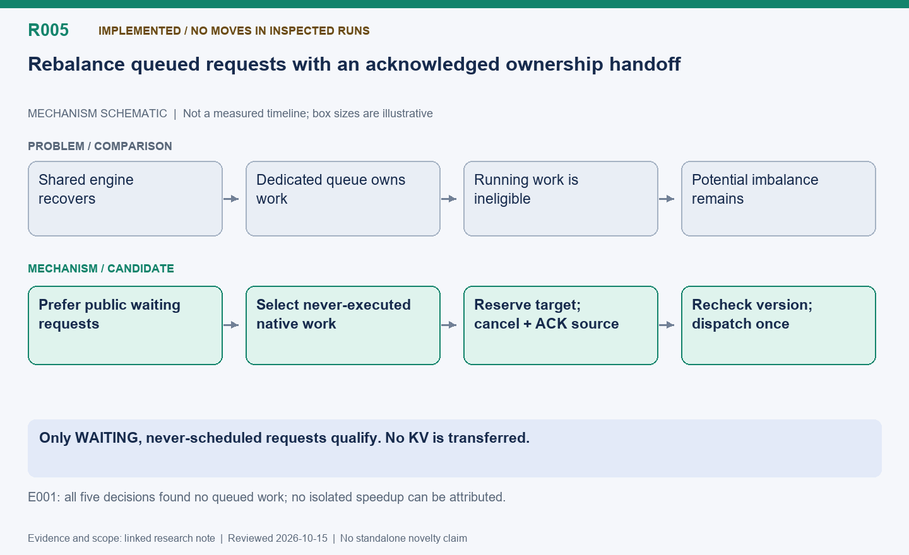

English | [中文](R005-queued-request-rebalancing.zh.md)

# R005: Cost-aware rebalancing of unexecuted requests

Status: Implemented; no eligible requests moved in the two inspected comparison runs.

Reviewed: 2026-10-15 (America/Vancouver). This is a historical evidence review, not a
new benchmark.

## Mechanism diagram

Only WAITING, never-scheduled requests qualify. No KV is transferred.

Schematic only: geometry does not encode time or bytes. Status and result boundaries
follow this note.

[SVG](R005.svg) | [PNG](R005.png)

## Problem and mechanism

When the shared replica returns, the dedicated replica may already own the remaining
work. An independent post-recovery assessment first prioritizes public waiting requests;
otherwise it considers only never-executed native queued requests. Predict source
completion, destination completion and aggregate tail using frozen calibration; reserve
destination capacity only if both request and tail gains exceed planning/query overhead.

## Safety and novelty boundary

Source cancellation is atomic in EngineCore and rechecks WAITING, zero computed/output
tokens and a never-scheduled marker. An internal attempt ID prevents cancelling a retry.
Hold the source lease until its HTTP response acknowledges cancellation; RPC timeout is
not success. Destination version/capacity is rechecked. This transfers ownership, not
KV. It is not R001: already-running or previously preempted requests are excluded.

## Measured outcome and remaining opportunity

Queue comparison: fixed 175.36 s, sharing without rebalance 152.81 s, enabled 151.73 s.
No requests were reassigned, so neither the 0.71% enabled/disabled difference nor the
13.48% shared/fixed difference proves rebalancing benefit. E001 again produced five
no_queued_work decisions. This is direct evidence of a policy applicability gap and
motivates running-request rebalancing, not proof that R001 will help.

## Next validation

Construct a genuinely queued workload and verify nonzero successful moves, ownership and
cancellation races; separately evaluate running-request migration. Keep instrumentation
equal and report skipped-decision reasons.

## Code locations

- [areal/infra/queue_rebalance.py](../../../../areal/infra/queue_rebalance.py)

- [areal/infra/request_router.py](../../../../areal/infra/request_router.py)

- [areal/engine/vllm_ext/queue_rebalance.py](../../../../areal/engine/vllm_ext/queue_rebalance.py)

- [areal/infra/controller/rollout_controller.py](../../../../areal/infra/controller/rollout_controller.py)

## Experiment evidence and conversation provenance

- [queue-rebalance-comparison01/results-summary.json](../experiments/evidence/history/queue-rebalance-comparison01/results-summary.json)

Conversation excerpt IDs: C121.
[Open excerpts](../experiments/evidence/conversation-excerpts.json)

Raw evidence root: `/root/areal-research-artifacts/history-20261015/`. This is a
selected archive, excluding model checkpoints and full profiler payloads; it is not a
complete runnable backup.

## Publication claim boundary

A contribution candidate identifies a mechanism worth studying, not established novelty;
a systematic related-work review is pending. Live RL can change output lengths,
consumption order and training trajectories. Percentages from different runs are not
additive. Without an isolated ablation, gains belong to the combined system.
