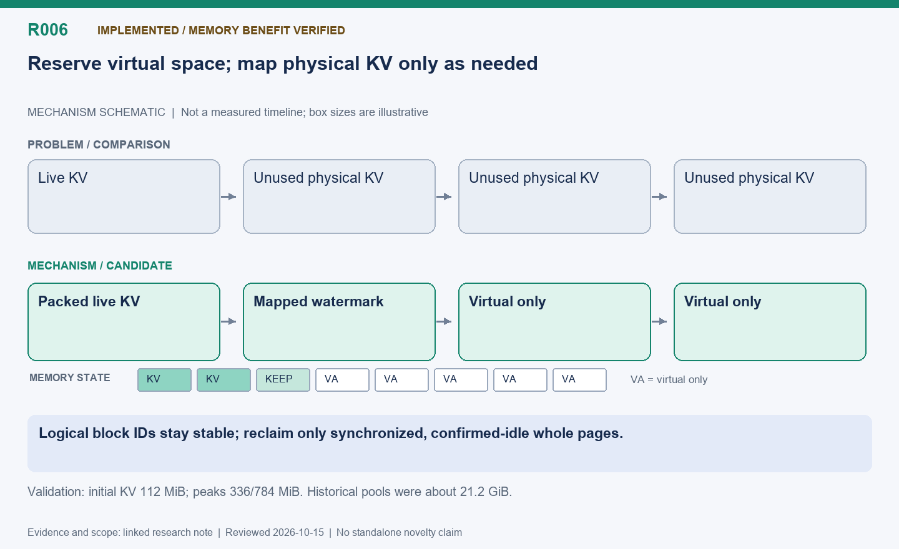

English | [中文](R006-dynamic-kv-pages.zh.md)

# R006: Demand-mapped physical KV pages with slab packing

Status: Implemented for validated Ascend layouts; memory savings verified, latency gain
not established in isolation.

Reviewed: 2026-10-15 (America/Vancouver). This is a historical evidence review, not a
new benchmark.

## Mechanism diagram

Logical block IDs stay stable; reclaim only synchronized, confirmed-idle whole pages.

Schematic only: geometry does not encode time or bytes. Status and result boundaries
follow this note.

[SVG](R006.svg) | [PNG](R006.png)

## Problem and mechanism

A logical block allocator can still reserve a large physical tensor. Historical
instances reserved about 21.2 GiB KV while sampled logical usage was only 0.9–2.1%.
First adapt FineServe-style packing (partially occupied slabs before empty ones), then
reserve virtual address space and map physical ACL pages only as retained block IDs
require them. Reclaim whole confirmed-idle page groups after synchronization; retain a
small watermark to reduce churn.

## Attribution and difficulty

FineServe contributes slab allocation ideas/code with retained BSD attribution;
distributed-runtime/CaMem motivated address-preserving physical mapping. The extension
is their integration with Ascend native per-layer K/V layout and RL memory handoffs, not
invention of slabs or virtual memory. FineServe’s inspected snapshot itself preallocated
the tensor. Protect every retained request, not only the current scheduled set; pin the
null block, zero new pages and fence partial failures. Physical page size need not equal
a logical slab.

## Measured outcome

Dynamic-KV validation: initial physical KV 112 MiB per instance; peaks 336/784 MiB,
versus historical pools near 21.2 GiB. All 192 answers completed in 84.30 s.
Fixed/dynamic-sharing comparison measured 82.79/83.97 s with 45604/47824 tokens; card-2
mean HBM fell 44.2%→12.6%. That comparison changes both sharing and allocation, so it
does not establish allocator speed or its overhead. Memory reduction may enable larger
workloads but does not automatically speed a small workload.

## Next validation

Within sharing, toggle AREAL_DYNAMIC_KV with identical work; separately time
map/zero/synchronize/unmap and sweep context/concurrency until saved memory matters. TP
extensions require the rank-level fences in R022; general models, arbitrary KV-copy
paths and graph capture are not validated by this experiment.

## Code locations

- [areal/engine/vllm_ext/kv_slab.py](../../../../areal/engine/vllm_ext/kv_slab.py)

- [areal/engine/vllm_ext/kv_slab_adapter.py](../../../../areal/engine/vllm_ext/kv_slab_adapter.py)

- [areal/engine/vllm_ext/dynamic_kv.py](../../../../areal/engine/vllm_ext/dynamic_kv.py)

- [areal/engine/vllm_ext/dynamic_kv_allocator.cpp](../../../../areal/engine/vllm_ext/dynamic_kv_allocator.cpp)

- [licenses/FineServe.txt](../../../../licenses/FineServe.txt)

## Experiment evidence and conversation provenance

- [kv-slab-smoke03/validation-summary.json](../experiments/evidence/history/kv-slab-smoke03/validation-summary.json)

- [dynamic-kv03/summary.json](../experiments/evidence/history/dynamic-kv03/summary.json)

- [dynamic-kv-ab01/comparison.json](../experiments/evidence/history/dynamic-kv-ab01/comparison.json)

Conversation excerpt IDs: C008, C079, C080, C081, C082.
[Open excerpts](../experiments/evidence/conversation-excerpts.json)

Raw evidence root: `/root/areal-research-artifacts/history-20261015/`. This is a
selected archive, excluding model checkpoints and full profiler payloads; it is not a
complete runnable backup.

## Publication claim boundary

A contribution candidate identifies a mechanism worth studying, not established novelty;
a systematic related-work review is pending. Live RL can change output lengths,
consumption order and training trajectories. Percentages from different runs are not
additive. Without an isolated ablation, gains belong to the combined system.
