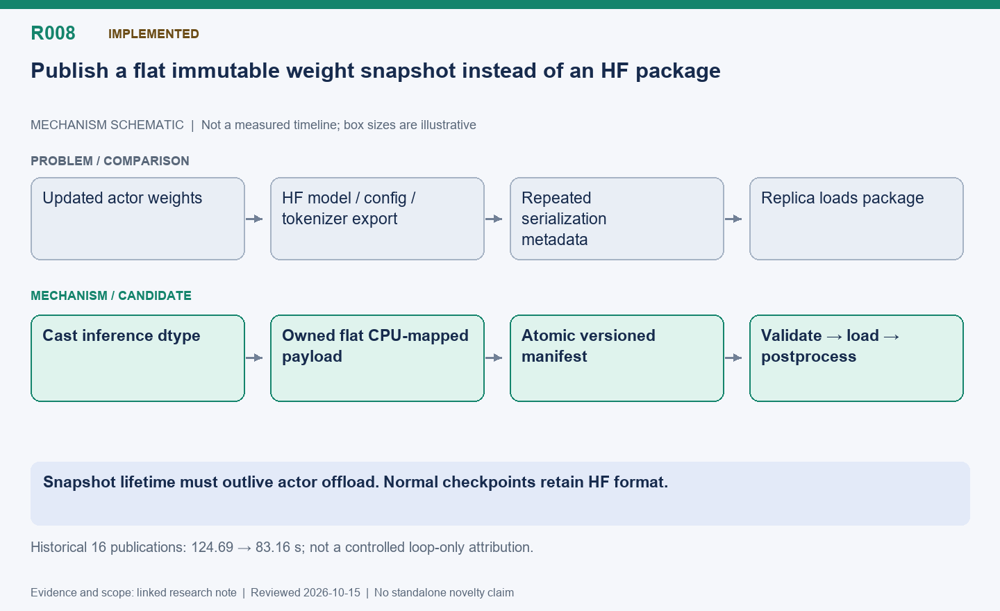

English | [中文](R008-flat-weight-snapshots.zh.md)

# R008: Flat versioned weight snapshots

Status: Implemented; historical publication cost reduction observed.

Reviewed: 2026-10-15 (America/Vancouver). This is a historical evidence review, not a
new benchmark.

## Mechanism diagram

Snapshot lifetime must outlive actor offload. Normal checkpoints retain HF format.

Schematic only: geometry does not encode time or bytes. Status and result boundaries
follow this note.

[SVG](R008.svg) | [PNG](R008.png)

## Problem and mechanism

Repeated HF model/config/tokenizer export is excessive for internal replica updates.
Convert weights to inference dtype, copy into an independently owned flat CPU-mapped
file, then atomically publish a versioned manifest. Validate names, sizes and bounds
before model.load_weights and Ascend postprocessing. Ordinary checkpoints retain HF
format.

## Optimization and difficulty

Avoid serialization metadata and repeated packaging while preserving immutable version
ownership. Preallocate file space to avoid sparse-tmpfs SIGBUS; shared reads must
outlive actor offload. Filesystem semantics and an extra CPU model-sized copy remain:
this is not universally zero-copy or disk-free. Multi-rank gathering needs a separate
coordinated path.

## Measured outcome

Sixteen publications fell from 124.69 to 83.16 s; mean 7.79→5.20 s, a 33.3% reduction.
Snapshot export averaged 2.01 s. Loop time fell 459.42→426.58 s, but remained slower
than fixed 397.32 s. Evaluation and sampled answers differed, so the 7.15% loop
reduction is not a controlled component-only gain.

## Next validation

Benchmark immutable identical tensors across formats, then measure end-to-end overlap
and host RAM/bandwidth. Include disk/tmpfs capacity failures and version mismatch tests.

## Code locations

- [areal/engine/weight_snapshot.py](../../../../areal/engine/weight_snapshot.py)

- [areal/engine/fsdp_engine.py](../../../../areal/engine/fsdp_engine.py)

- [areal/engine/vllm_ext/vllm_worker_extension.py](../../../../areal/engine/vllm_ext/vllm_worker_extension.py)

## Experiment evidence and conversation provenance

- [npu-share-fast01/comparison.json](../experiments/evidence/history/npu-share-fast01/comparison.json)

- [npu-share-ab01/comparison.json](../experiments/evidence/history/npu-share-ab01/comparison.json)

Conversation excerpt IDs: C016.
[Open excerpts](../experiments/evidence/conversation-excerpts.json)

Raw evidence root: `/root/areal-research-artifacts/history-20261015/`. This is a
selected archive, excluding model checkpoints and full profiler payloads; it is not a
complete runnable backup.

## Publication claim boundary

A contribution candidate identifies a mechanism worth studying, not established novelty;
a systematic related-work review is pending. Live RL can change output lengths,
consumption order and training trajectories. Percentages from different runs are not
additive. Without an isolated ablation, gains belong to the combined system.
