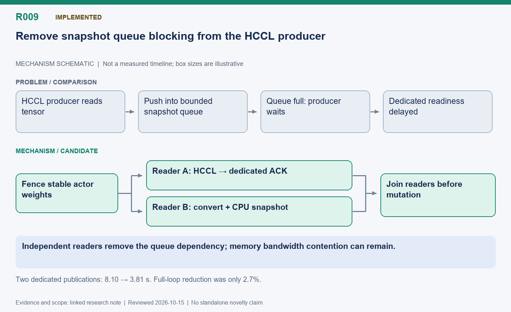

[English](R009-independent-snapshot-reader.md) | 中文

# R009: 独立快照读取线程，解除 HCCL 队列阻塞

状态：已实现；短对照中发布阶段直接耗时改善。

整理日期：2026-10-15（America/Vancouver）。本页按历史证据整理，不代表重新实测。

## 机制示意图

**读图：** 不是简单增加线程，而是拆开读取路径：HCCL 和快照线程独立读取已稳定的权重，不再由 HCCL 生产者向有界队列投递。下一次改写权重之前仍必须等待所有读取结束。

此图仅表达机制，不按时间或显存大小绘制；状态和结果边界以本文为准。

[SVG](R009.svg) | [PNG](R009.png)

## 问题与思路

仅有后台消费者还不够：若 HCCL 生产者提交快照张量时被有界队列阻塞，专用卡仍变慢。让快照线程独立读取稳定训练权重，HCCL
只等自己的传输和加载确认；快照在专用流中独立转换和复制。先确认优化器完成，下次修改或卸载权重前等待读取结束。

## 优化点与难点

关键是去掉依赖，而不是单纯增加线程。避免第二次未协调的 FSDP 集体遍历，额外转换显存控制为一个张量。独立流仍会争带宽，不能把重叠视为免费。最初读取器假设单训练 rank，多
rank 要用后续明确的汇集协议。

## 实测收益与局限

16 题并发、3 批、关闭同步设备计时：前两批专用卡发布从 4.09/4.02 降到 2.07/1.74 秒，合计 8.10→3.81 秒，减少 53%。总循环
104.07→101.26 秒，少 2.7%，token 为 46650/46616；保存时间也快约 1.21
秒且题目组合不同。因此发布阶段证据最直接，不能把总收益全归给线程改动；旧固定基线没有重跑。

## 下一步

保留队列提交等待、流等待、HCCL ACK 和快照就绪事件，用相同张量重复；在大模型下测通信竞争。

## 代码位置

- [areal/engine/fsdp_engine.py](../../../../areal/engine/fsdp_engine.py)

- [areal/engine/weight_snapshot.py](../../../../areal/engine/weight_snapshot.py)

- [tests/test_fused_snapshot_publication.py](../../../../tests/test_fused_snapshot_publication.py)

## 实验证据与会话来源

- `independent-reader01`: 日志与脚本见持久历史归档。

会话摘录编号：C040, C041, C047. [查看摘录](../experiments/evidence/conversation-excerpts.json)

原始证据根目录：`/root/areal-research-artifacts/history-20261015/`. 这是选择性归档，未包含模型检查点和完整 profiler
大文件；并非完整可运行备份。

## 论文表述约束

本页所说的“候选贡献”仅表示值得研究的机制，没有完成系统相关工作检索，不能据此声称首次提出。单次实时 RL
的回答长度、消费顺序和训练轨迹可能变化；不同实验的百分比不能相加。未单独消融的收益只能归于组合方案。

## 补充的本机分析产物

- [independent-reader-comparison.json](../experiments/evidence/supplementary/independent-reader-comparison.json)
- [independent-reader-publication.json](../experiments/evidence/supplementary/independent-reader-publication.json)
