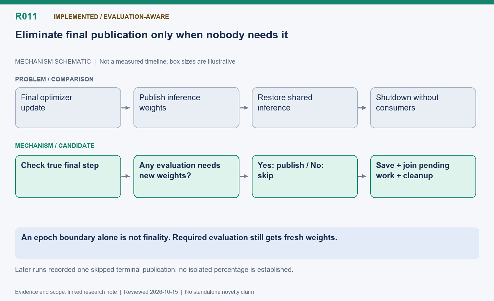

[English](R011-terminal-publication-elision.md) | 中文

# R011: 跳过最终批次无用途的发布与推理恢复

状态：已实现，终止判断考虑评估需求。

整理日期：2026-10-15（America/Vancouver）。本页按历史证据整理，不代表重新实测。

## 机制示意图

**读图：** 只有确定训练真正结束且没有评估需要新权重时，才跳过无用的推理权重发布和恢复。最终模型保存、已有后台任务汇合及清理仍然执行。

此图仅表达机制，不按时间或显存大小绘制；状态和结果边界以本文为准。

[SVG](R011.svg) | [PNG](R011.png)

## 问题与思路

训练真正结束且没有评估需要新权重时，恢复推理是在做无人消费的工作。根据 epoch 推导步数与 total_train_steps
判断真实最后一步；跳过专用发布、共享快照、内存切换和推理重开，但保留要求的模型/恢复状态保存、统计和清理。

## 难点与优化点

epoch 边界未必就是结束；若到期评估，则仍要发布以使用训练后的权重。已经启动的后台工作必须在销毁前完成。它属于消除末尾无用工作，适合作为工程优化，不宜独立声称新调度算法。

## 证据与收益

后续三批、六批摘要均记录
terminal_publications_skipped=1。尚未找到严格同输入开关消融，不能编造独立收益百分比。独立读取器实验三次训练仅两次发布正是此规则生效。

## 下一步

用相同输入比较末尾发布开关，并核对最终保存权重及有无评估两种路径。

## 代码位置

- [areal/trainer/rl_trainer.py](../../../../areal/trainer/rl_trainer.py)

## 实验证据与会话来源

- `terminal-tail01`: 日志与脚本见持久历史归档。

- [post-warmup-ab01/comparison.json](../experiments/evidence/history/post-warmup-ab01/comparison.json)

会话摘录编号：C043. [查看摘录](../experiments/evidence/conversation-excerpts.json)

原始证据根目录：`/root/areal-research-artifacts/history-20261015/`. 这是选择性归档，未包含模型检查点和完整 profiler
大文件；并非完整可运行备份。

## 论文表述约束

本页所说的“候选贡献”仅表示值得研究的机制，没有完成系统相关工作检索，不能据此声称首次提出。单次实时 RL
的回答长度、消费顺序和训练轨迹可能变化；不同实验的百分比不能相加。未单独消融的收益只能归于组合方案。
