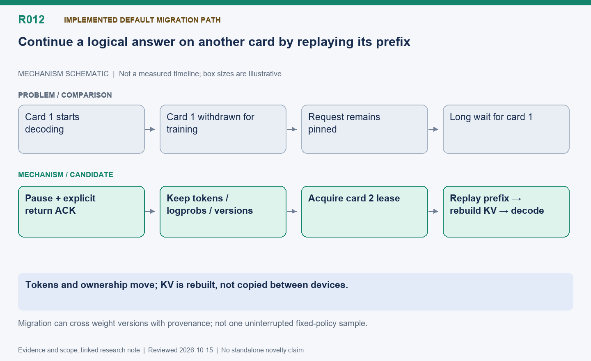

English | [中文](R012-request-leases-and-migration.zh.md)

# R012: Lease-based routing and cross-card continuation

Status: Implemented default migration path; KV is rebuilt, not transferred.

Reviewed: 2026-10-15 (America/Vancouver). This is a historical evidence review, not a
new benchmark.

## Mechanism diagram

Tokens and ownership move; KV is rebuilt, not copied between devices.

Schematic only: geometry does not encode time or bytes. Status and result boundaries
follow this note.

[SVG](R012.svg) | [PNG](R012.png)

## Problem and mechanism

A request pinned to a shared card can wait through training. Acquire a per-segment
engine lease from a common queue. On withdrawal, close admission, pause native inference
and wait for explicit returns; retain output tokens, log probabilities and per-token
versions, then reacquire another engine and replay the accumulated prefix. CPU
workflow/reward ownership need not match the physical generation device.

## Correctness and difficulty

Serialize native enqueue with pause; late arrivals receive explicit retry semantics. An
HTTP timeout can leave execution ambiguous and must fail closed, not duplicate the
request. Continuation can cross weight versions with recorded per-token provenance: it
is not equivalent to one uninterrupted fixed-policy sample. Preserve
importance-weight/off-policy semantics and bound staleness; no direct cross-device KV
transfer is implemented.

## Measured outcome

Historical traces show successful card-1-to-2 continuation and complete logical answers.
A later migration arm completed 576 answers with 152 cross-card answers in 167.09 s; the
100-batch combined policy measured a 12.33% loop reduction. Neither isolates routing
alone. Prefix replay can waste compute, and small per-card decode batches can offset
extra device capacity (R013).

## Next validation

Measure repeated-prefix tokens and ownership gaps separately from final output. Add
error injection and a quality comparison; use R018 to contrast same-version retained
execution and R001 for the opposite rebalance direction.

## Code locations

- [areal/infra/request_router.py](../../../../areal/infra/request_router.py)

- [areal/infra/borrowed_rollout.py](../../../../areal/infra/borrowed_rollout.py)

- [areal/infra/controller/rollout_controller.py](../../../../areal/infra/controller/rollout_controller.py)

- [areal/engine/vllm_ext/areal_vllm_server.py](../../../../areal/engine/vllm_ext/areal_vllm_server.py)

## Experiment evidence and conversation provenance

- `npu-share-taskaffinity01`: Logs/scripts are in the persistent historical archive.

- [pause-retain-ab01/comparison.json](../experiments/evidence/history/pause-retain-ab01/comparison.json)

- `hundred-batches01`: Logs/scripts are in the persistent historical archive.

Conversation excerpt IDs: C030, C034, C091.
[Open excerpts](../experiments/evidence/conversation-excerpts.json)

Raw evidence root: `/root/areal-research-artifacts/history-20261015/`. This is a
selected archive, excluding model checkpoints and full profiler payloads; it is not a
complete runnable backup.

## Publication claim boundary

A contribution candidate identifies a mechanism worth studying, not established novelty;
a systematic related-work review is pending. Live RL can change output lengths,
consumption order and training trajectories. Percentages from different runs are not
additive. Without an isolated ablation, gains belong to the combined system.
