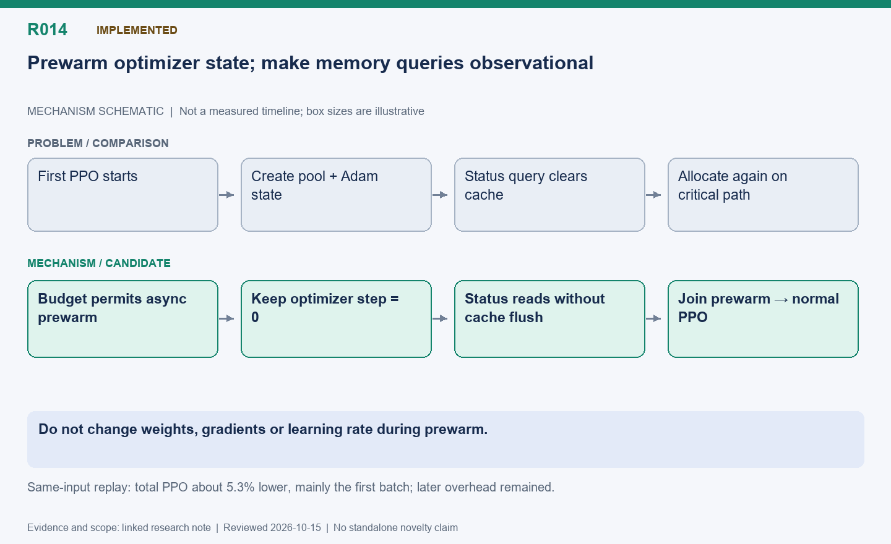

[English](R014-optimizer-prewarm-and-pure-status.md) | 中文

# R014: 优化器预热与无副作用的显存状态查询

状态：已实现；同输入回放显示首批改善。

整理日期：2026-10-15（America/Vancouver）。本页按历史证据整理，不代表重新实测。

## 机制示意图

**读图：** 显存预算允许时提前异步创建优化器池和状态，优化器步数仍为零，不更新参数。内存状态查询去掉清缓存副作用，训练使用前等待预热完成。

此图仅表达机制，不按时间或显存大小绘制；状态和结果边界以本文为准。

[SVG](R014.svg) | [PNG](R014.png)

## 问题与思路

首次 Adam 使用会在关键路径创建池和大量状态张量，显存状态查询此前还会清缓存。预算允许时提前异步准备池和状态，step
仍为零，不更新权重、学习率或梯度。状态查询只观测，保留覆盖和预算检查，去掉无条件 empty_cache 和设备同步。

## 难点与优化点

显存不足时只建池；流完成后才公布初始化状态，训练、保存加载、卸载和销毁前都要等待。分配器回调对象必须保持有效生命周期。优化的是首次分配与观测副作用，不改变优化器数学。

## 实测收益

同输入回放最初共享 PPO 为 4.894/3.726/3.662 秒，固定为 4.394/3.473/3.408 秒。预热与纯状态查询后共享变为
4.259/3.702/3.671 秒，三批合计少约 5.3%，主要改善第一批。第二、三批反向传播仍有额外成本，引出 R015；单纯预算允许时保留缓存也未完全消除差距。

## 下一步

分别计时建池、Adam 分配、清零和同步；检查权重及优化器连续性。预热是把初始化移前，不代表这部分工作消失。

## 代码位置

- [areal/engine/fsdp_engine.py](../../../../areal/engine/fsdp_engine.py)

- [areal/engine/colocation_memory.py](../../../../areal/engine/colocation_memory.py)

- [areal/trainer/colocation_memory.py](../../../../areal/trainer/colocation_memory.py)

## 实验证据与会话来源

- [ppo-replay01/comparison.json](../experiments/evidence/history/ppo-replay01/comparison.json)

- [ppo-replay01/weight-comparison.json](../experiments/evidence/history/ppo-replay01/weight-comparison.json)

- [ppo-prewarm02/comparison.json](../experiments/evidence/history/ppo-prewarm02/comparison.json)

- [ppo-cache-budget01/comparison.json](../experiments/evidence/history/ppo-cache-budget01/comparison.json)

会话摘录编号：C049, C052, C055. [查看摘录](../experiments/evidence/conversation-excerpts.json)

原始证据根目录：`/root/areal-research-artifacts/history-20261015/`. 这是选择性归档，未包含模型检查点和完整 profiler
大文件；并非完整可运行备份。

## 论文表述约束

本页所说的“候选贡献”仅表示值得研究的机制，没有完成系统相关工作检索，不能据此声称首次提出。单次实时 RL
的回答长度、消费顺序和训练轨迹可能变化；不同实验的百分比不能相加。未单独消融的收益只能归于组合方案。
