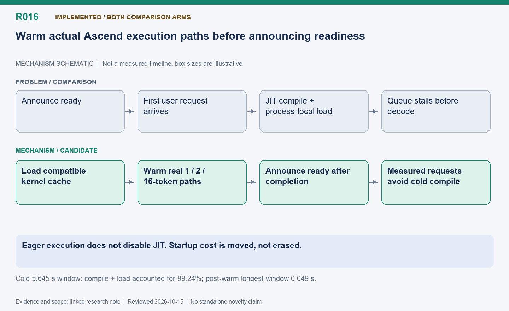

English | [中文](R016-ascend-kernel-warmup.zh.md)

# R016: Warm real Ascend request kernels before readiness

Status: Implemented for supported APIs; applies to fixed and shared modes.

Reviewed: 2026-10-15 (America/Vancouver). This is a historical evidence review, not a
new benchmark.

## Mechanism diagram

Eager execution does not disable JIT. Startup cost is moved, not erased.

Schematic only: geometry does not encode time or bytes. Status and result boundaries
follow this note.

[SVG](R016.svg) | [PNG](R016.png)

## Problem and mechanism

A timeline showing one long running request and others queued was dominated by first-use
Triton compilation/loading, not multi-second NPU token computation. Persist a compatible
Triton cache and warm real model/block-table paths for 1, 2 and 16 tokens before
readiness. Eager execution does not disable JIT; persistent binaries still need
process-local loading.

## Optimization and difficulty

Move shape-specific initialization before measured requests and distinguish service
initialization from training-loop time. Warm the actual shape/API rather than an
unrelated dummy operation. Fail initialization if supported warmup fails; log
unsupported API skips. Cache compatibility depends on compiler, hardware and code. This
is a startup correctness/performance fix, not a new general warmup algorithm.

## Measured outcome

Cold/cache diagnosis: first windows about 10.63/0.154 s, longest single-token window
5.645/0.053 s. The cold 5.645 s contained 3.776 s RoPE compilation and 1.826 s loading
(99.24%). After warmup, cold-cache first window was about 0.17 s and longest
single-token window 0.049 s; three validation runs reported no new compilation/loading
during training. Cold startup warmup cost about 17 s, cached about 0.125 s. Subsequent
fixed/shared loops 83.96/83.14 s were nearly tied with differing token counts.

## Next validation

Report startup plus steady state for cold and warm caches. New model/shape/backend
combinations need renewed coverage; avoid treating host-side execute windows as
exclusive NPU occupancy.

## Code locations

- [areal/engine/vllm_ext/ascend_kernel_warmup.py](../../../../areal/engine/vllm_ext/ascend_kernel_warmup.py)

- [areal/engine/vllm_ext/vllm_worker_extension.py](../../../../areal/engine/vllm_ext/vllm_worker_extension.py)

## Experiment evidence and conversation provenance

- [cold-start-diag02/comparison.json](../experiments/evidence/history/cold-start-diag02/comparison.json)

- [kernel-warmup02/comparison.json](../experiments/evidence/history/kernel-warmup02/comparison.json)

- [post-warmup-ab01/comparison.json](../experiments/evidence/history/post-warmup-ab01/comparison.json)

Conversation excerpt IDs: C069, C070, C071.
[Open excerpts](../experiments/evidence/conversation-excerpts.json)

Raw evidence root: `/root/areal-research-artifacts/history-20261015/`. This is a
selected archive, excluding model checkpoints and full profiler payloads; it is not a
complete runnable backup.

## Publication claim boundary

A contribution candidate identifies a mechanism worth studying, not established novelty;
a systematic related-work review is pending. Live RL can change output lengths,
consumption order and training trajectories. Percentages from different runs are not
additive. Without an isolated ablation, gains belong to the combined system.
