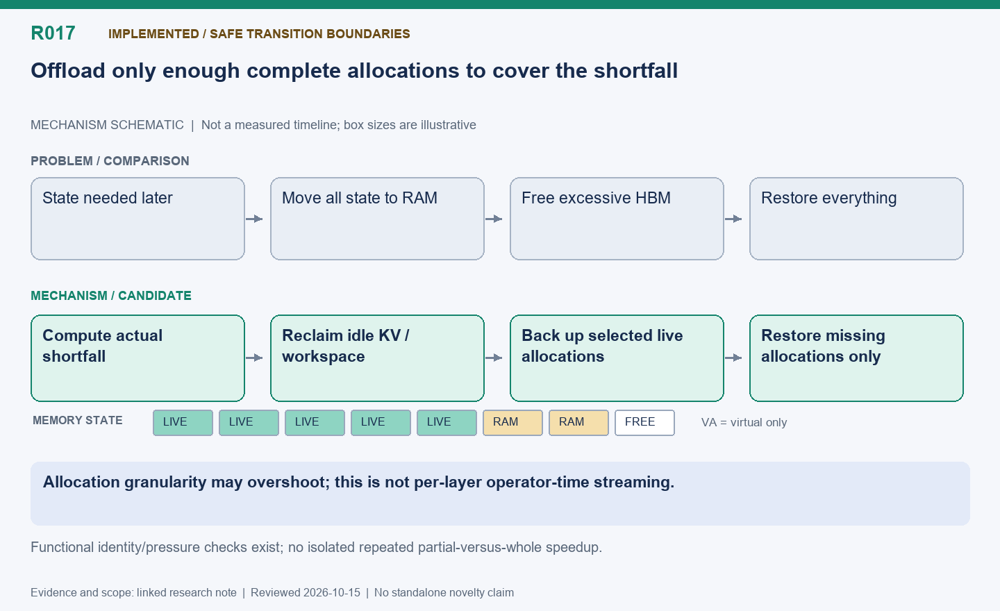

English | [中文](R017-pressure-driven-partial-offload.zh.md)

# R017: Pressure-driven partial offload of resident state

Status: Implemented at safe transition boundaries, not arbitrary operator-time paging.

Reviewed: 2026-10-15 (America/Vancouver). This is a historical evidence review, not a
new benchmark.

## Mechanism diagram

Allocation granularity may overshoot; this is not per-layer operator-time streaming.

Schematic only: geometry does not encode time or bytes. Status and result boundaries
follow this note.

[SVG](R017.svg) | [PNG](R017.png)

## Problem and mechanism

Whole-pool offload moves too much state even when the next stage lacks only a small
amount of memory. Keep allocations resident when free space satisfies the budget.
Otherwise reclaim idle workspace/KV first, then back up enough complete optimizer or
weight allocations to host RAM. Restore only missing allocations at original addresses
before use. A block can overshoot the byte shortfall; this is not layer-wise weight
streaming.

## Difficulty and optimization point

Compute shortfall from real free space and configured cap, including pending
optimizer/gradient/workspace growth. Do not double-count reclaimable allocator cache as
guaranteed free memory. Preserve tensor objects and optimizer identity; stale host
copies must not overwrite newer weights. Live data require backup, inactive bytes do
not. Partial map/copy failure keeps execution closed; do not retry a half-completed PPO
step after OOM.

## Evidence and limits

The earlier whole-pool pressure test used effective budgets null/48/37.5/37.5 GiB
without changing physical memory, exercised four optimizer updates and backed up 18.75
GiB of training state. It checked identities/addresses plus sampled edge bytes, not full
tensors. Later pressure-memory02 records the partial policy, but no isolated, repeated
same-input partial-versus-whole speedup was recovered. These functional tests must not
be presented as a throughput result.

## Next validation

At fixed dynamic-KV settings, sweep pressure and allocation granularity; report bytes
moved, transition latency, RAM peaks and complete-loop time. Attribute CaMem/ACL
primitives correctly; the policy integration is the candidate optimization.

## Code locations

- [areal/engine/colocation_memory.py](../../../../areal/engine/colocation_memory.py)

- [areal/trainer/colocation_memory.py](../../../../areal/trainer/colocation_memory.py)

- [areal/engine/fsdp_engine.py](../../../../areal/engine/fsdp_engine.py)

- [areal/engine/vllm_ext/vllm_worker_extension.py](../../../../areal/engine/vllm_ext/vllm_worker_extension.py)

## Experiment evidence and conversation provenance

- [auto-memory-pressure01/validation-summary.json](../experiments/evidence/history/auto-memory-pressure01/validation-summary.json)

- `pressure-memory02`: Logs/scripts are in the persistent historical archive.

Conversation excerpt IDs: C010, C080.
[Open excerpts](../experiments/evidence/conversation-excerpts.json)

Raw evidence root: `/root/areal-research-artifacts/history-20261015/`. This is a
selected archive, excluding model checkpoints and full profiler payloads; it is not a
complete runnable backup.

## Publication claim boundary

A contribution candidate identifies a mechanism worth studying, not established novelty;
a systematic related-work review is pending. Live RL can change output lengths,
consumption order and training trajectories. Percentages from different runs are not
additive. Without an isolated ablation, gains belong to the combined system.

## Supplementary laptop analyses

- [pressure-memory-timeline.json](../experiments/evidence/supplementary/pressure-memory-timeline.json)
