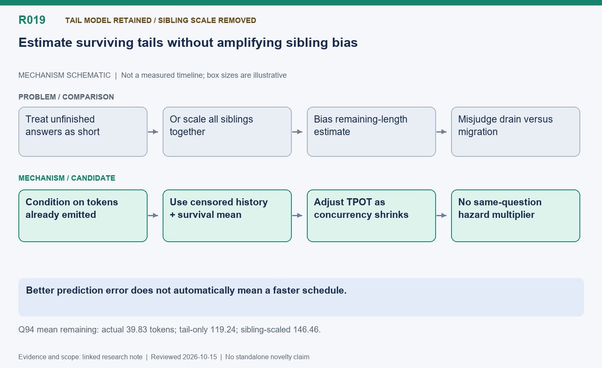

[English](R019-tail-estimation-and-sibling-ablation.md) | 中文

# R019: 长尾预测与被移除的同题缩放策略

状态：保留尾部和动态服务修正；同题缩放已删除，启动前排序仍仅离线研究。

整理日期：2026-10-15（America/Vancouver）。本页按历史证据整理，不代表重新实测。

## 机制示意图

**读图：** 未完成回答属于截尾观测，按已生成长度估计条件剩余长度，并考虑活跃并发降低时 TPOT 的变化。去掉会共同放大同题回答预测偏差的乘数，同时保留失败证据。

此图仅表达机制，不按时间或显存大小绘制；状态和结果边界以本文为准。

[SVG](R019.svg) | [PNG](R019.png)

## 问题与思路

未完成回答是删失观测，不能当作已完成短回答。根据已经生成长度且尚未终止这一条件估计剩余长度，用受限生存均值修正尾部，再随活动解码并发变化模拟完成。随后尝试用同题终止数/暴露量缩放同题分布，但因放大偏差而删除。启动前按提示词长度排序只做了离线评估，未部署。

## 同题策略为何失败

96 道题中 61 道最长/最短至少两倍，中位数 2.66。更关键的是题 94：六个回答已生成 180–184 token 都未结束，事后平均只剩 39.83；纯尾部预测
119.24，加同题缩放变 146.46。方法把正常的尚未终止误判为整题偏长，把所有同题回答一起上调。这不能证明所有同题信息都没价值。

## 预测与运行结果

同输入八次决策回放，收齐时间 MAE：旧 4.29 秒、仅尾部 2.91、尾部加同题 3.31、全部修正 3.18。删除同题后另一次实时决策 MAE 从 3.73→2.14
秒，但循环反而 154.28→154.98 秒，token 不同。单独共享请求回放中运行时剩余 token MAE 77.46→65.14，改善 15.9%；启动前仅
88.20→86.96，改善 1.4%，排序相关性约 0.19。MAE 更好不等于排序更好或训练更快。

## 候选贡献与下一步

有研究价值的是异步采样下带不确定性的剩余工作估计，不是已被否定的具体启发式。在留出窗口评估条件校准、删失处理、排序相关、决策损失及计算成本。把同题负面结果作为消融保留，不能重新包装成已证明优化。

## 代码位置

- [areal/infra/rolling_drain.py](../../../../areal/infra/rolling_drain.py)

- [areal/infra/drain_prediction.py](../../../../areal/infra/drain_prediction.py)

## 实验证据与会话来源

- [refined-drain-comparison01/comparison.json](../experiments/evidence/history/refined-drain-comparison01/comparison.json)

- [refined-drain-comparison01/results-summary.json](../experiments/evidence/history/refined-drain-comparison01/results-summary.json)

- [no-sibling-comparison01/results-summary.json](../experiments/evidence/history/no-sibling-comparison01/results-summary.json)

- [tail-prediction01/summary.json](../experiments/evidence/history/tail-prediction01/summary.json)

会话摘录编号：C115, C116, C117, C127.
[查看摘录](../experiments/evidence/conversation-excerpts.json)

原始证据根目录：`/root/areal-research-artifacts/history-20261015/`. 这是选择性归档，未包含模型检查点和完整 profiler
大文件；并非完整可运行备份。

## 论文表述约束

本页所说的“候选贡献”仅表示值得研究的机制，没有完成系统相关工作检索，不能据此声称首次提出。单次实时 RL
的回答长度、消费顺序和训练轨迹可能变化；不同实验的百分比不能相加。未单独消融的收益只能归于组合方案。

## 补充的本机分析产物

- [sibling-diagnosis.json](../experiments/evidence/supplementary/sibling-diagnosis.json)
