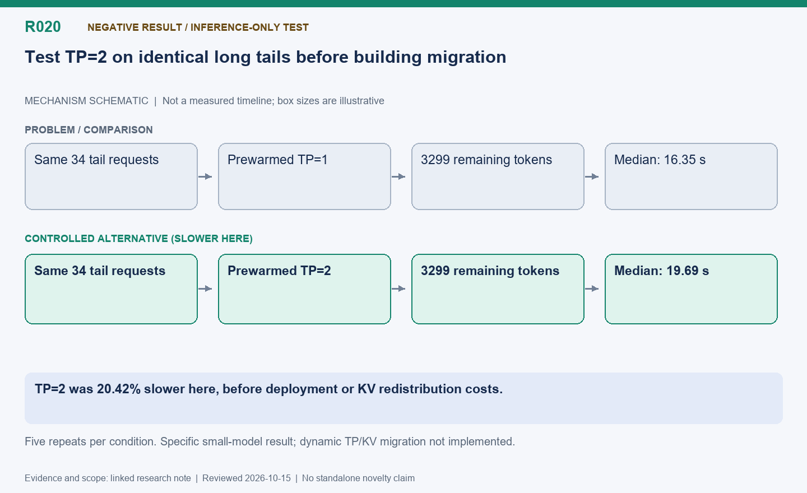

[English](R020-tp-tail-negative-result.md) | 中文

# R020: 预热 TP=2 加速长尾的负面实验

状态：已测纯推理备选；没有实现动态 TP 或 KV 迁移。

整理日期：2026-10-15（America/Vancouver）。本页按历史证据整理，不代表重新实测。

## 机制示意图

**读图：** 使用相同长尾请求和固定剩余 token 数，在预热好的 TP1 与 TP2 实例分别重复测试。TP2 此处反而更慢，因此不应将双卡单实例迁移包装成已成功的优化。

此图仅表达机制，不按时间或显存大小绘制；状态和结果边界以本文为准。

[SVG](R020.svg) | [PNG](R020.png)

## 问题与方法

最后少量请求能否由两张设备共同解码更快？预热 TP=1/TP=2，回放相同 34 个尾部请求、固定剩余 3299 token，另测最后一个 275-token
请求。每种重复五次，按 TP1 前测、TP2、TP1 后测顺序，排除模型初始化和预热。

## 实测结果

整组 TP1 合并中位数 16.35 秒，TP2 19.69 秒，TP2 慢 20.42%；单请求 15.09 对 18.32 秒，慢 21.38%；预留卡秒约
2.41–2.43 倍。即使不计部署和 KV 迁移成本，这个小模型负载也没有收益。

## 解释与难点

分片可能增加通信并缩小算子，本实验未隔离每项原因。DP 增加独立请求容量，但不能拆开单个自回归依赖链。把现有 KV 重新分成 TP
分片还是另一项未实现问题。结论只适用于本模型、硬件和请求形状，不是全面否定 TP。

## 下一步

只有更大模型或单请求确实受计算限制的证据出现时再尝试；分开部署、预热、重新分布和稳态成本。本项作为设计空间负面结果保存，而不是成功优化。

## 代码位置

仅保留实验脚本，未合入生产调度；见持久归档。

## 实验证据与会话来源

- [tp-tail01/summary.json](../experiments/evidence/history/tp-tail01/summary.json)

会话摘录编号：C124. [查看摘录](../experiments/evidence/conversation-excerpts.json)

原始证据根目录：`/root/areal-research-artifacts/history-20261015/`. 这是选择性归档，未包含模型检查点和完整 profiler
大文件；并非完整可运行备份。

## 论文表述约束

本页所说的“候选贡献”仅表示值得研究的机制，没有完成系统相关工作检索，不能据此声称首次提出。单次实时 RL
的回答长度、消费顺序和训练轨迹可能变化；不同实验的百分比不能相加。未单独消融的收益只能归于组合方案。
