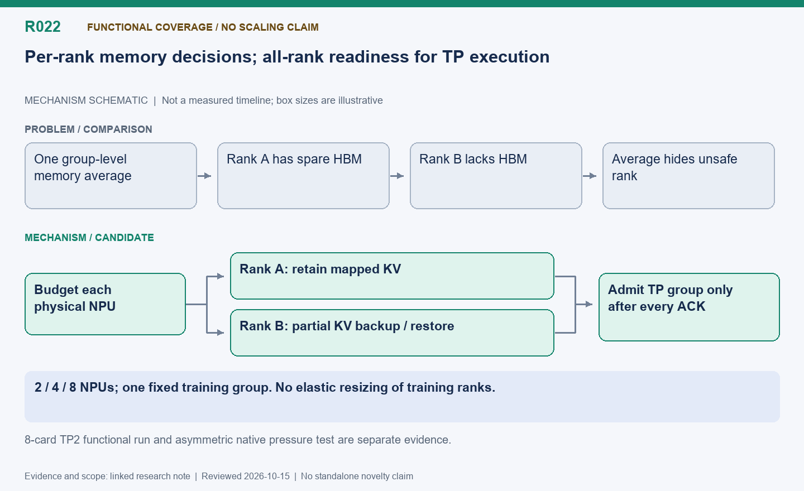

[English](R022-multi-npu-rank-budgets.md) | 中文

# R022: 多推理实例与 TP 逐卡显存预算

状态：近期未提交扩展；4 卡 TP1、8 卡 TP2 有功能覆盖，尚无严格配对扩展收益结论。

整理日期：2026-10-15（America/Vancouver）。本页按历史证据整理，不代表重新实测。

## 机制示意图

**读图：** 显存预算逐卡判断，宽裕的卡不搬，紧张的卡只处理自己的缺口；但 TP 实例必须等全部成员就绪才能执行。多卡不是多个独立训练任务，也不是弹性改变训练组成员。

此图仅表达机制，不按时间或显存大小绘制；状态和结果边界以本文为准。

[SVG](R022.svg) | [PNG](R022.png)

## 问题与思路

原双卡代码写死一个 actor 和两个引擎。扩为 2/4/8 卡，一个训练组占一半，推理实例的 TP 宽度整除推理半区；共享实例借用训练卡。汇总状态不能只看 rank
0；各卡独立回收自己的短缺量，所有 TP 成员就绪后才允许整组执行。

## 难点与优化点

映射控制 rank、实例、成员到物理卡；多训练 rank 全权重发布、组确认和部分失败需要协调。调度器钩子必须装在 EngineCore，不能只装设备
worker；同卡训练推理还要避开 HCCL 端口冲突。改容量时保持活跃块编号。够空间的卡保留 KV，受压卡单独搬暂停有效 KV 到 RAM，但集体执行仍要等最慢未就绪
rank。

## 功能证据

8 卡 TP2 共享验证完成 32 题每题六答、两批，79.51 秒；第一批 PPO 与两个借用实例各 44 个执行窗口相交，各约 2.58
秒；第二批已无剩余推理。另一个非对称原生测试仅一张卡回收 4 MiB，另一卡保留，逐字节恢复通过。它们是不同测试，不能说该 RL 本身触发了压力。TP4
尚未端到端验证，不声称扩展加速。

## 下一步

做同条件固定/共享 4/8 卡对照，单独压迫一个 TP 成员，记录集体等待和逐卡显存。这是固定拓扑上的角色和准入变化，不是训练进程组弹性扩缩。

## 代码位置

- [areal/infra/scheduler/local.py](../../../../areal/infra/scheduler/local.py)

- [areal/infra/controller/rollout_controller.py](../../../../areal/infra/controller/rollout_controller.py)

- [areal/infra/controller/train_controller.py](../../../../areal/infra/controller/train_controller.py)

- [areal/trainer/colocation_memory.py](../../../../areal/trainer/colocation_memory.py)

- [areal/engine/vllm_ext/dynamic_kv.py](../../../../areal/engine/vllm_ext/dynamic_kv.py)

- [areal/engine/vllm_ext/kv_slab.py](../../../../areal/engine/vllm_ext/kv_slab.py)

- [areal/engine/vllm_remote.py](../../../../areal/engine/vllm_remote.py)

## 实验证据与会话来源

会话摘录编号：C143. [查看摘录](../experiments/evidence/conversation-excerpts.json)

原始证据根目录：`/root/areal-research-artifacts/history-20261015/`. 这是选择性归档，未包含模型检查点和完整 profiler
大文件；并非完整可运行备份。

## 论文表述约束

本页所说的“候选贡献”仅表示值得研究的机制，没有完成系统相关工作检索，不能据此声称首次提出。单次实时 RL
的回答长度、消费顺序和训练轨迹可能变化；不同实验的百分比不能相加。未单独消融的收益只能归于组合方案。

[TP2 validation](../experiments/evidence/multi-npu/validation-summary.json)

[Native asymmetric memory test](../experiments/evidence/multi-npu/native-asymmetric-kv.log)
