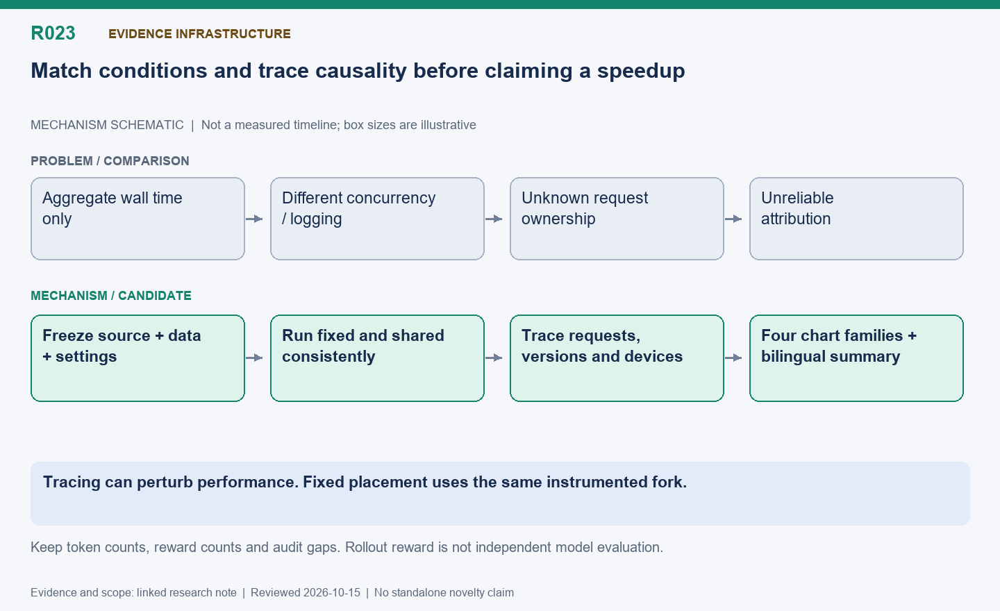

[English](R023-observability-and-reproducibility.md) | 中文

# R023: 可选观测与可复现对照测试工具

状态：已实现实验基础设施；跟踪本身可能影响性能。

整理日期：2026-10-15（America/Vancouver）。本页按历史证据整理，不代表重新实测。

## 机制示意图

**读图：**
冻结代码、数据和参数，固定与共享保持一致的并发、日志及沙箱限制，记录请求、版本和设备事件，再生成四类图和双语总结。观测本身可能影响性能，固定组也不是未经修改的上游代码。

此图仅表达机制，不按时间或显存大小绘制；状态和结果边界以本文为准。

[SVG](R023.svg) | [PNG](R023.png)

## 问题与思路

平均利用率看不出路由、暂停和编译卡顿。记录请求/题目/尝试 ID、实际消费批次、引擎、版本、排队暂停恢复和设备窗口、TTFT/TPOT 及完成。同步设备跟踪默认关闭，CPU
进度统计独立。脚本冻结同一源码快照，保留配置、数据、镜像哈希，运行匹配模式，在库外生成阶段、请求、利用率和 token 图。

## 公平性修正与难点

固定基线是同一带观测 fork 的固定放置模式，不是完全未改上游。匹配全局题目并发和沙箱奖励并发：首轮 code 对比误成全局 4 对 8，已作废，重跑两组均全局
4。限制精确提交工作量，避免无用预取悄悄改变对比。设备跟踪关闭时不能编造 NPU 时间。

## 证据与局限

修正后 code 对比：固定 218.93 秒/71823 token，共享 211.09 秒/69395 token，通过 26/288 和 31/288。这是
rollout 奖励，不是训练前后独立质量评估。两秒利用率会漏短峰，HBM 含缓存预留，token 柱图按单 token
解码结束重建。重叠窗口不是每请求独占计算，同种子实时运行也可能产生不同回答、批次和梯度。

## 研究价值与下一步

本项提供因果主张所需证据基础，自身不是吞吐优化。应补无同步跟踪重复、源码/补丁哈希、off-policy 设置、实际长度、评估和不确定性，用证据目录避免混比不兼容历史实验。

## 代码位置

- [areal/utils/request_trace.py](../../../../areal/utils/request_trace.py)

- [areal/engine/vllm_ext/areal_vllm_server.py](../../../../areal/engine/vllm_ext/areal_vllm_server.py)

- `benchmark/npu_share/run_bench.py`

- `benchmark/npu_share/render.py`

## 实验证据与会话来源

- `fair-overlap-trace01`: 日志与脚本见持久历史归档。

- [code-three-batches02/comparison.json](../experiments/evidence/history/code-three-batches02/comparison.json)

- [queue-rebalance-comparison01/results-summary.json](../experiments/evidence/history/queue-rebalance-comparison01/results-summary.json)

会话摘录编号：C095, C121. [查看摘录](../experiments/evidence/conversation-excerpts.json)

原始证据根目录：`/root/areal-research-artifacts/history-20261015/`. 这是选择性归档，未包含模型检查点和完整 profiler
大文件；并非完整可运行备份。

## 论文表述约束

本页所说的“候选贡献”仅表示值得研究的机制，没有完成系统相关工作检索，不能据此声称首次提出。单次实时 RL
的回答长度、消费顺序和训练轨迹可能变化；不同实验的百分比不能相加。未单独消融的收益只能归于组合方案。

上述尚未提交的代码路径记录本次检查时的工作区位置，不包含在研究文档提交中；可在对应实验源码快照中追溯。
