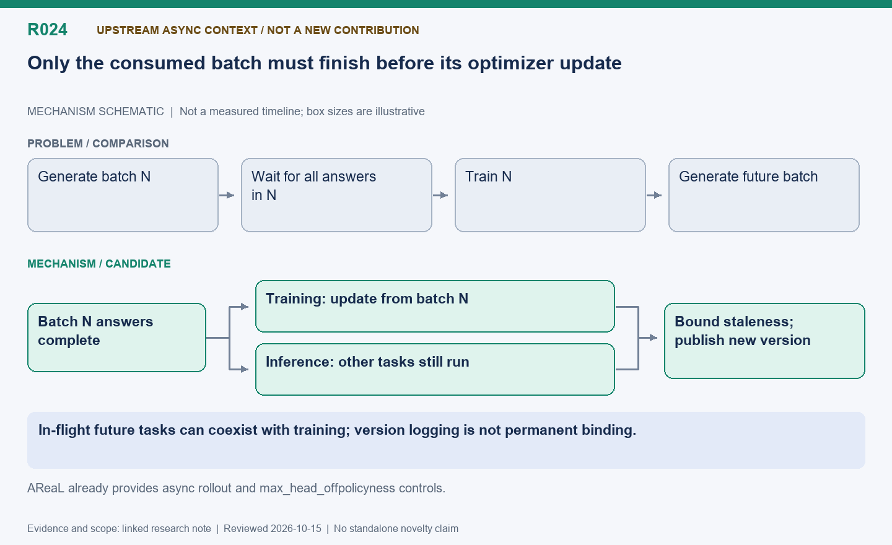

English | [中文](R024-async-and-multiversion-context.zh.md)

# R024: Asynchronous rollout and multi-version experiments: context

Status: Historical exploration; upstream capability and this project’s extensions must
be separated.

Reviewed: 2026-10-15 (America/Vancouver). This is a historical evidence review, not a
new benchmark.

## Mechanism diagram

In-flight future tasks can coexist with training; version logging is not permanent
binding.

Schematic only: geometry does not encode time or bytes. Status and result boundaries
follow this note.

[SVG](R024.svg) | [PNG](R024.png)

## Question and scope

The session began by testing coexistence of model versions, then overlapping rollout for
future work with training on a completed batch. A task/question is smaller than a
training batch; only the consumed batch must be complete before its update. Other
in-flight tasks can use older versions within the configured staleness bound. This
motivated borrowing otherwise-idle training resources later.

## Attribution and design boundary

AReaL already provides asynchronous rollout and off-policy controls. Changing
max_head_offpolicyness or demonstrating concurrent batches is not an original
contribution here. Later replica-specific readiness, memory sharing and cost policies
are the extension. Permanent multi-version request binding and KV transfer must not be
inferred from per-token version logging.

## Evidence and unresolved questions

Retained multiversion/overlap/scale directories support the chronology. This review does
not promote the conversational 419-versus-147-second sketch into a controlled headline
result without reconstructing its exact scope. Earlier two-replica coexistence lasting
only seconds was a feasibility demonstration, not evidence that the extra device was
worthwhile.

## Next validation

For a paper, clearly name the upstream asynchronous baseline and independently ablate
resource sharing. Audit per-token versions, importance ratios and quality under
staleness; do not conflate speed comparisons with learning improvements.

## Code locations

- [areal/infra/controller/rollout_controller.py](../../../../areal/infra/controller/rollout_controller.py)

## Experiment evidence and conversation provenance

- `multiversion-smoke01`: Logs/scripts are in the persistent historical archive.

- `overlap-smoke01`: Logs/scripts are in the persistent historical archive.

- `scale-smoke01`: Logs/scripts are in the persistent historical archive.

Raw evidence root: `/root/areal-research-artifacts/history-20261015/`. This is a
selected archive, excluding model checkpoints and full profiler payloads; it is not a
complete runnable backup.

## Publication claim boundary

A contribution candidate identifies a mechanism worth studying, not established novelty;
a systematic related-work review is pending. Live RL can change output lengths,
consumption order and training trajectories. Percentages from different runs are not
additive. Without an isolated ablation, gains belong to the combined system.
