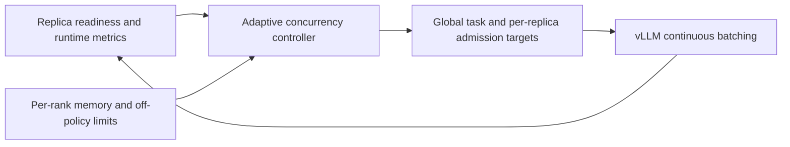

English | [中文](R025-adaptive-inference-concurrency.zh.md)

# R025: Capacity-aware adaptive inference concurrency

Status: Capacity-driven admission implemented; positive development evidence; formal
confirmation pending. Recorded: 2026-10-19 (America/Vancouver), from the user's proposal
in this session. Primary mechanism: M2 scheduling; M1 supplies safe memory/capacity
bounds and M3 supplies replica/version readiness. This is not a fourth core mechanism.

## Current implementation update (2026-10-20)

The benchmark now enables `--adaptive-concurrency capacity` by default for the shared
arm; `off` remains an explicit ablation. The historical twofold cap was removed after
the initial experiment. The current target is `ceil(C * R / F)`, where C is baseline
question concurrency, R is the count of ready compatible inference replicas, and F is
the dedicated replica count. Executor capacity is bounded by the configured total
replica count using the same ratio, not by 2\*C. TP ranks within an instance are not
independent replicas. This assumes equivalent replicas; heterogeneous engine throughput
weighting is not implemented.

At baseline 16, capacity ratios 1.5, 2, 3 and 4 yield targets 24, 32, 48 and 64. Growth
remains gradual and blocked by router backlog. Off-policy, engine sequence and token
limits, and per-rank memory constraints remain independent gates; a higher target does
not guarantee that many running tasks. With inference:training 2:1 the maximum
shared/dedicated capacity ratio is 1.5, and with 3:1 it is 4/3.

Nine policy tests pass, covering fractional ratios, growth above twofold, withdrawal and
preserved staleness bounds. The earlier measured 15.40% improvement belongs to the
initial two-instance development experiment; neither uncapped multi-instance scaling nor
unequal allocation has a new measured speedup here. Initial-version descriptions
below/above are retained as historical provenance.

Implementation: `areal/infra/adaptive_concurrency.py` computes the target;
`rollout_controller.py` derives topology capacity; `staleness_manager.py` combines the
target with version limits; `workflow_executor.py` rechecks admission after capacity
returns. Tests: `tests/test_adaptive_concurrency.py`.

## Original idea

The number of concurrent inference requests is bounded by configuration. When more NPUs
become available for inference, more requests could be admitted concurrently. More
generally, adjust the concurrency target dynamically from current runtime conditions
instead of keeping one target for the entire run.

## Current behavior and the problem to investigate

The configured ceiling and actual running count are different. `RolloutController`
initializes a global `max_concurrent_rollouts` (falling back to consumer batch size).
`StalenessManager` already computes admission capacity from running/accepted work and
version staleness; actual capacity is not constant. Router capacity is initialized from
`max_num_seqs`. vLLM already performs continuous batching. R025 proposes adapting the
targets across these layers; it does not claim to invent dynamic batching.

A single static ceiling may underfill newly restored shared inference capacity, while a
permanently high ceiling may increase queueing, KV memory pressure, contention and
training-readiness delay when that capacity disappears. These are hypotheses to test,
not established explanations for previous results.

## Concurrency units

| Unit                              | Meaning and constraint                                                                    |
| --------------------------------- | ----------------------------------------------------------------------------------------- |
| Concurrent question/rollout tasks | Global admitted tasks; each may generate several answers.                                 |
| In-flight answer requests         | Includes requests waiting in routing/native queues; not necessarily executing.            |
| Scheduled inference sequences     | Requests actually scheduled by each vLLM instance, bounded by sequence and token budgets. |
| Available inference replicas      | Version-ready instances with usable compute and memory capacity.                          |

Six answers per question do not imply that all six execute simultaneously. Keep
questions per training batch, answers per question, and off-policy limits unchanged when
evaluating concurrency control alone.

## Proposed approach

1. Observe replica readiness, queued/running work, output throughput, TTFT/TPOT,
   batch-ready forecasts, and per-rank free/KV memory. Prefer existing lightweight
   counters; do not introduce synchronous device queries on the hot path.
1. On shared-replica restoration or removal, recompute the available admission budget.
   Use effective replica capacity, not raw NPU count: adding TP ranks to one instance is
   different from adding an independent replica. Within TP, the limiting rank must
   constrain safe admission.
1. Maintain a global question target and per-replica request targets. Start by adapting
   soft admission limits below preconfigured, supported engine hard limits; do not
   assume vLLM startup settings can be changed safely at runtime.
1. Increase admission gradually when pending work exists and extra concurrency improves
   useful throughput or batch readiness without memory pressure. Reduce new admission
   when capacity shrinks, TPOT deteriorates, memory pressure grows, or training needs
   the devices. Existing requests may drain; lowering a target alone must not force
   migration or cancellation.
1. Bound changes with hysteresis, a minimum adjustment interval, and fallback to the
   configured baseline if observations are sparse or unreliable. A rolling window of up
   to three completed batches is an initial candidate, not a decided algorithm.

Off-policy capacity, version compatibility, per-rank memory safety and training priority
remain hard constraints. More available NPUs permit reconsidering the target; they do
not guarantee that increasing it is beneficial. Avoid starving long requests.

## Relation to existing records and research question

R013 studied configured concurrency and question affinity; R025 proposes closed-loop
adaptation during a run. R005/R001 move already admitted work; R025 primarily controls
how much new work enters the system. R004 predicts training readiness, R022 supplies
TP-aware resource limits, and M3 indicates which replicas are ready.

The contribution candidate is coordinated, training-aware admission under changing
shared capacity. Adaptive concurrency itself is not presumed novel. Related-work review
and isolated ablations are required before any novelty or speedup claim.

## Implementation locations

- `areal/infra/controller/rollout_controller.py`: initialize capacity and react to
  replica readiness.
- `areal/infra/staleness_manager.py`: combine a changing concurrency target with
  existing staleness bounds.
- Router admission and per-replica capacity handling reached through the controller.
- Existing per-rank budget and prediction interfaces; exact APIs require review before
  implementation.
- `benchmark/npu_share/`: expose/reproduce comparison settings and record target
  changes.

## Validation and failure cases

Compare static 16, static 32 (and an appropriate stronger static baseline),
capacity-only scaling, and feedback-driven adaptation. Hold model, data, batch size,
answer count, policy/version limits, logging, memory and migration policies constant.
Test stable fixed capacity, shared restoration/withdrawal, TP=1/2, short and long
answers, and memory-constrained or already saturated workloads. Use reused engines only
for exploration; use independent startup for final confirmation.

Record target trajectories, actual scheduled sequences, queue delay, TTFT/TPOT, output
tokens, batch-ready and training-loop time, per-rank memory, control overhead, training
waiting, version age and quality. Repeat trials and distinguish changed output work from
scheduling benefit. A target that never changes or is always clipped by another limit is
a non-triggering result, not a successful adaptation.

Potential failures include oscillation, increased tail latency, extra offload/migration,
long-request starvation and no benefit after kernel saturation. Retain these results.
The desired outcome is benefit where static admission underfills capacity, with a
measured low-overhead fallback elsewhere; no universal non-regression guarantee exists.

## Evidence

Development evidence is recorded below. Previous concurrency experiments motivate the
hypothesis but do not validate this policy.

## Historical first implementation: capacity adaptation (2026-10-20)

Enable with `--adaptive-concurrency capacity` in the benchmark, or
`AREAL_ADAPTIVE_CONCURRENCY=capacity` for the shared rollout controller. Default is off;
the fixed arm remains unchanged. This first implementation does not estimate throughput.

For baseline question concurrency C and F dedicated inference replicas, let R be the
number of routing-ready replicas at the current version, excluding closing replicas. The
desired target is `min(2*C, ceil(C*R/F))`. Borrowed training/draining state caps it at
C. Growth is limited to `max(1, C//4)` questions per second and is inhibited while
requests wait at the router. Capacity loss lowers new admission immediately, including
to zero when no compatible replica is ready. Existing requests are not canceled.

The staleness manager clips the target against its unchanged off-policy bound. vLLM
sequence/token limits and all per-rank memory admission checks remain unchanged. This
controls global question admission, not a new per-replica native scheduler. TP ranks are
not independent replicas. The controller uses small in-memory snapshots, no device RPC.
Dynamic dispatch rechecks capacity every 0.5 seconds so restored replicas need not wait
for another request completion. The configured pending queue size is unchanged.

`adaptive_concurrency` trace events record baseline, target, ready replicas, ceiling,
queue count and reason. This is a bounded capacity heuristic, not yet the full
throughput/latency feedback proposal. It cannot guarantee non-regression.

Development tooling can alternate `--shared-concurrency-modes off,capacity,off,capacity`
with `--repetitions 4`. Each repetition still runs fixed then shared; original DRAM
weights are restored and checked. These reused-engine results are exploratory only. The
accompanying tool repair destroys all per-peer KV communication groups on an idle
session reset; this is not an R025 research contribution.

## Development evidence (2026-10-20)

Two reused-engine comparisons reduced shared-loop time by 12.42% and 18.32%; mean
reduction 15.40%. Actual question overlap increased from 16 to 32. This is exploratory
evidence, not independent-start confirmation or a comparison against static 32. See the
[experiment record](../experiments/2026-10-20-r025-capacity-admission.md).
