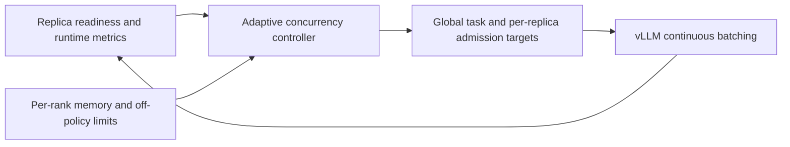

[English](R025-adaptive-inference-concurrency.md) | 中文

# R025：容量感知的动态推理并发控制

状态：已实现容量自适应准入，取得开发实验正向证据，正式确认待进行。 记录日期：2026-10-19（America/Vancouver），来源为用户在本会话提出的想法。
归属：M2 调度机制；M1 提供安全显存与容量边界，M3 提供副本及版本就绪状态。 不另立第四个核心机制。

## 当前实现更新（2026-10-20）

benchmark 现在默认对共享组启用 `--adaptive-concurrency capacity`，可用 `off` 显式关闭作消融。
初版实验后已移除固定两倍上限。当前目标为 `ceil(C * R / F)`：C 为基准题目并发， R 为当前兼容且就绪的推理实例数，F
为固定推理实例数。执行器容量同样按配置的实例总数比例计算， 不再固定为 2\*C。一个 TP 实例内的多个 rank 不算独立实例。当前假设实例能力相当，尚未实现异构吞吐加权。

基准 16 时，能力比例 1.5、2、3、4 分别对应目标 24、32、48、64。仍逐步增长，路由排队时暂停增长。 off-policy、引擎序列/token
限制和逐卡显存约束保持独立；目标变大不保证实际运行数量相同。 推理:训练为 2:1 时，共享/固定的最大能力比为 1.5；3:1 时为 4/3。

9 项策略测试通过，覆盖非整数比例、超过两倍、撤回和陈旧度约束。 此前平均 15.40% 的收益属于初版双实例开发实验，不能作为取消上限后的多实例或不等比例实测收益。
文中初版描述保留作为历史过程，当前行为以本节为准。

实现对应：`areal/infra/adaptive_concurrency.py` 计算目标；`rollout_controller.py`
推导拓扑容量；`staleness_manager.py` 结合版本边界；`workflow_executor.py` 在容量恢复后重新检查准入。测试见
`tests/test_adaptive_concurrency.py`。

## 原始想法

当前可同时运行的推理数量受到若干配置项限制。当用于推理的 NPU 增多时， 可以允许更多请求同时推理。进一步，可以根据当前运行情况动态调整并发目标，
而不是整个实验始终采用一个固定目标。

## 当前机制与待解决的问题

配置上限不等于实际运行数量。`RolloutController` 初始化全局
`max_concurrent_rollouts`，未设置时回退到消费批次大小；`StalenessManager`
已根据运行中、已接收任务和版本陈旧度计算可新增任务容量，因此现有实际容量 本来就在变化。路由容量由 `max_num_seqs` 初始化；vLLM 本身也已有
continuous batching。R025 要研究的是这些层次的目标值如何联动调整，而不是重新提出动态批处理。

固定并发上限可能使恢复后的共享推理实例吃不满；始终设得很高，又可能在共享卡 回到训练时增加排队、KV 显存压力、资源竞争和训练等待。这是待验证假设，不能
直接视作此前性能结果的已确认原因。

## 区分四种数量

| 数量                     | 含义与约束                                                |
| ------------------------ | --------------------------------------------------------- |
| 并发题目／rollout 任务数 | 全局准入的任务，每题可能生成多个回答。                    |
| 在途回答请求数           | 包含路由或引擎队列中等待的请求，不等于正在执行。          |
| 实际调度的推理序列数     | 每个 vLLM 实例实际调度的序列，受序列数及 token 预算约束。 |
| 当前可用推理实例数       | 版本就绪且有可用计算和显存容量的实例。                    |

每题六个回答不意味着六个回答总是同时执行。单独比较并发控制时，不改变每批 题目数、每题回答数和 off-policy 限制。

## 初步方案

1. 采集副本就绪、排队／执行请求数、输出吞吐量、TTFT／TPOT、批次收齐预测及 逐 rank 的可用显存／KV 占用。优先复用轻量计数器，不在热路径增加同步设备查询。
1. 共享实例恢复或退出时重新评估准入预算。依据有效实例容量，不按物理卡数简单 线性放大：同一实例增加 TP 卡数，与新增独立实例不同；TP 内受限的 rank 必须
   约束安全准入量。
1. 同时维护全局题目并发目标和逐实例请求目标。优先在预配置的引擎硬上限之下 动态调整软准入上限，不假设 vLLM 启动配置都可以安全热修改。
1. 有待处理工作且增加并发能改善有效吞吐或批次就绪时间、显存无压力时，逐步 增加准入；容量减少、TPOT 恶化、显存紧张或训练需要卡时，减少新增准入。
   已运行请求可以自然完成，不能仅因降低目标就强制迁移或取消。
1. 加入滞回、最短调整间隔及观测不足时回退配置基线的机制。最多三个已完成批次 的滑动窗口可作为起点候选，尚未确定具体算法。

off-policy 容量、版本兼容、逐卡显存安全和训练优先仍是硬约束。卡数增加只是 重新评估并发目标的机会，不保证增加并发一定获益；还需避免长请求饥饿。

## 与已有研究的关系及候选研究点

R013 研究配置并发及题目亲和；R025 研究运行过程中的闭环调整。 R005／R001 搬移已经准入的工作；R025 主要控制新工作的准入数量。 R004
提供训练就绪预测，R022 提供 TP 逐卡资源约束，M3 提供副本就绪信息。

候选贡献是共享容量变化时、面向训练就绪的分层准入控制。不能把“自适应并发” 本身直接称为新颖算法；需要相关工作检索及独立消融。

## 实现位置

- `areal/infra/controller/rollout_controller.py`：初始化容量、响应副本就绪变化。
- `areal/infra/staleness_manager.py`：将动态并发目标与已有陈旧度边界结合。
- 控制器调用的路由准入及逐实例容量管理。
- 已有逐卡显存预算和预测接口；实现前需要核对具体 API。
- `benchmark/npu_share/`：复现对比参数，记录目标调整轨迹。

## 验证方案与可能失败的情况

比较固定 16、固定 32（及适合该负载的更强静态基线）、仅按容量缩放、运行反馈 自适应四类方案。保持模型、数据、批大小、回答数、版本限制、日志、显存及迁移
策略一致。覆盖固定容量、共享恢复／撤回、TP=1/2、长短回答、显存受限和引擎已 饱和等场景。探索阶段可复用 vLLM，正式确认采用独立启动。

记录目标变化、实际调度序列数、排队时间、TTFT／TPOT、token 数、批次收齐和 训练循环时间、逐卡显存、控制开销、训练等待、版本年龄及质量；重复测量并区分
输出工作量变化。目标从未变化，或始终被另一上限截住，属于未触发，不能算成功。

可能失败于振荡、长尾变差、额外卸载或迁移、长请求饥饿，以及引擎已饱和时毫无 收益。负面结果也应保留。目标是在静态准入不足的场景获得收益，在其他场景以
低开销回退；不能预先保证对所有场景都没有负收益。

## 证据状态

本版实现与开发实验见下文。此前的并发对比提供研究动机，本次证据仍不构成正式确认。

## 历史第一版实现：按可用容量动态准入（2026-10-20）

已实现，取得开发实验正向证据，正式确认待进行。基准脚本使用 `--adaptive-concurrency capacity` 开启， 默认
`off`，固定组保持原逻辑。该版本先验证容量自适应，不宣称已实现吞吐预测。

令 C 为基准题目并发，F 为固定推理实例数，R 为当前版本就绪且未关闭的实例数， 目标为 `min(2*C, ceil(C*R/F))`。共享侧处于训练或撤回状态时上限退回
C。 每秒最多增加 `max(1, C//4)` 题；路由层已有等待请求时暂停增长。 容量减少立即限制新准入；无可用实例时可降至零，不取消已经运行的请求。

offpolicy 上限、vLLM 的序列/token 硬限制和逐卡显存预算都保持不变。 本版调整全局题目准入，没有实现新的逐实例原生调度器；TP 内部各卡不算独立实例。
只读取内存中的轻量状态，不在热路径查询 NPU；动态模式每 0.5 秒重查可用容量， 因此共享实例恢复后不用等另一请求完成才能补充工作。待处理队列配置不变。

日志事件 `adaptive_concurrency` 记录基准、目标、可用实例数、上限、等待数和原因。
这仍是有界容量启发式，尚非完整吞吐/延迟反馈控制，也不保证所有负载均无回退。

开发工具可使用 `--repetitions 4 --shared-concurrency-modes off,capacity,off,capacity`
交替测试。每轮仍先固定后共享并恢复、校验初始权重，结果只作探索性证据。 同时修复复用工具清理多对端 KV 通信组的遗漏；工具修复不算 R025 研究贡献。

## 开发实验证据（2026-10-20）

两次复用引擎对照中，共享循环耗时分别减少 12.42% 和 18.32%，均值减少 15.40%。实际题目重叠峰值由 16 升到
32。这是探索性证据，尚非独立启动确认，也未与固定并发 32
比较。见[实验记录](../experiments/2026-10-20-r025-capacity-admission.zh.md)。
