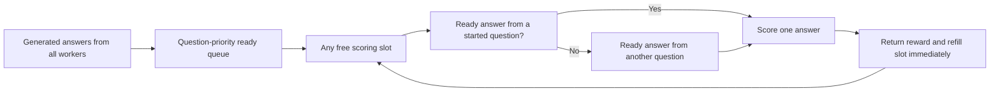

English | [中文](R029-training-ready-reward-scheduling.zh.md)

# R029: Reward scheduling for training-batch readiness

Recorded: 2026-10-22 (America/Vancouver). Category: Scheduling; extends **M2:
training-readiness-aware scheduling**, not a fourth core mechanism. Status:
Generation/reward admission separation and work-conserving question-priority scoring are
implemented. Two repeated fixed/shared development comparisons completed. No publication
novelty claim is established.

## Problem and observed evidence

Code rewards run generated programs in an E2B/Kuasar sandbox. They do not require the
training NPU. The previous controller held a generation slot until sandbox grading
completed. With four sandbox slots, reward waiting starved model generation even when
inference devices were idle. Blind round-robin worker dispatch added local head-of-line
blocking.

Separating admission removed that starvation, but scoring still queues individual
answers. Shared inference finishes more answers from more questions early. Completed
rewards can therefore be spread over many partially scored questions. Training
requires32 complete questions with8 rewards each;256 arbitrary completed rewards are
insufficient. This is a scheduling hypothesis supported by observed batch-ready delays,
not an isolated causal ablation of the new question policy.

| Metric                   | Decoupled fixed | Decoupled shared |
| ------------------------ | --------------: | ---------------: |
| Training loop            |        522.16 s |         524.57 s |
| All768 answers generated |         85.69 s |          49.96 s |
| Batch1 rewards ready     |        173.31 s |         209.17 s |
| Batch2 rewards ready     |        329.06 s |         381.40 s |
| Output tokens            |          191845 |           185927 |
| Scoring service window   |        442.43 s |         424.08 s |

Shared was0.46% slower overall despite earlier generation completion. Preserve this
negative result. The earlier coupled run measured509.53/509.01 seconds; that comparison
is not a controlled attribution because generated tokens, weight-version exposure and
external sandbox load can differ.

## Implemented foundation

1. Explicit terminal-generation completion releases one question slot only after every
   answer has finished generation. Pending rewards remain counted against off-policy and
   unfinished-work bounds.
1. Least-loaded eligible worker placement excludes reward waiting from generation load;
   withdrawn shared workers remain ineligible.
1. Rewards must still complete before acceptance into a training batch. Duplicate
   notifications, cancellation and submission races have regression coverage.

## Work-conserving question priority (2026-10-22 revision)

The current optional `question` policy replaces the whole-question lease. Each generated
answer is registered immediately. Sixteen individual scoring slots select pending
answers across rollout processes: already-started questions first, then question arrival
order and sample index. If a preferred question has only running or not-yet-generated
answers, other questions fill available slots. Individual results return immediately; no
full-generation or full-scoring barrier remains. The fixed arm continues to use `answer`
scheduling.

A shared SQLite registry contains only admission metadata, not generated code or
callbacks. A short transaction chooses requests; numeric file locks enforce the
aggregate default limit of sixteen. Metadata I/O runs outside the inference event loop
and outside the scoring threads. Each chosen callback calls `grade_in_slot` because its
capacity lease is already held. Dead-worker liveness leases prevent abandoned priority
heads from starving peers. Pending cancellation removes admission records; started calls
drain before releasing their slots. Dispatcher failure cleans up its live-owner records.

The coordinator is arm-local and requires a shared local filesystem. It is not
remote-service reservation or a multi-node coordinator. Priority uses readiness and
progress only, never the reward value. Ten scoring regressions plus fifteen runner tests
passed, including cross-process capacity, partial generation, cross-question overlap,
cancellation, infrastructure errors, dead owners and dispatcher failures. Two
reused-vLLM fixed/shared pairs completed with the unchanged 96-question workload (32 per
batch, 8 answers, concurrency16, three batches, offpolicy2).

## Contribution and implementation challenges

The optimization objective is complete-question readiness for training, rather than only
individual reward latency. Question priority and per-answer admission are separate:
prefer finishing useful groups while keeping capacity available to other ready work. The
generation/reward admission split prevents sandbox waiting from occupying inference
concurrency. These are implementations of M2, not independent core mechanisms or a
proven novelty claim.

Coordination must cover all rollout processes in an arm. A local thread pool alone
cannot enforce global ordering or capacity. Metadata arbitration must not occupy scoring
threads, and cancelled blocking calls must keep their leases until actual completion.
Result identities and reward values remain unchanged; infrastructure failures still
propagate.

## Code locations

- `areal/infra/generation_admission.py`, workflow context and grouped workflow: terminal
  generation aggregation.
- `areal/infra/staleness_manager.py`, workflow executor, rollout controller and
  `borrowed_rollout.py`: separate generation capacity and load-aware placement.
- `benchmark/npu_share/templates/question_rewards.py`: shared admission metadata,
  question priority and per-answer capacity leases.
- `benchmark/npu_share/templates/code_workflow.py`, `code_reward.py`: workflow adapter
  and scoring entry points.
- `benchmark/npu_share/run_bench.py`: fixed answer baseline and optional shared question
  policy.
- `benchmark/npu_share/test_question_rewards.py`: admission and failure regression
  tests.

## Validation and boundaries

Compare fixed answer scheduling with shared question priority using identical configured
workload, model and four-slot scoring capacity. Report training starts,
completed-question milestones, slot utilization, service costs, loop times, tokens and
errors. Reused-vLLM experiments are development evidence; formal confirmation requires
independent starts. Generated programs and external sandbox load may differ, so timing
differences are not automatically causal attribution to scheduling.

The service is shared with other sessions; this coordinator does not globally cap their
traffic. Scheduling can change which questions reach training first, so long-run quality
and version-age distributions need separate evaluation. Finite-window FIFO priority does
not implement a general distributed fairness guarantee. Group metadata is retained for
the lifetime of the rollout process; very long-lived deployment should add bounded
retirement.

The admission-separation motivation is documented in
[evidence/r029-20261022](../experiments/evidence/r029-20261022). Raw benchmark
workspaces remain outside the repository. Benchmark orchestration and reporting are
experimental tools, not research contributions.

## Development outcome

[Full paired results](../experiments/2026-10-22-r029-work-conserving.md). All four arms
completed, each with96 questions and768 scores, zero scoring infrastructure errors and
peak scoring concurrency4. Shared slot occupancy was99.21%/99.29%, with different
questions overlapping for169.11/181.54 seconds. First-batch training started28.64/31.27
seconds earlier than paired fixed. Second-batch starts improved17.22 seconds in pair1
but regressed2.22 seconds in pair2.

Loop times were518.85/557.16 seconds (fixed/shared) in pair1 and543.32/538.70 seconds in
pair2. Thus shared was7.38% slower in pair1 and0.85% faster in pair2; a repeatable
whole-loop speedup is not established. The first-pair excess time was dominated by
higher observed scoring service work, not idle-slot time. Generated programs and shared
sandbox load confound causal attribution. The optional mechanism remains available
without changing the fixed baseline or the default answer policy.

## Scoring capacity default (2026-10-23)

The benchmark adapters now share `DEFAULT_REWARD_CONCURRENCY = 8` across answer
scheduling, question-priority leases and scoring thread pools. This is an arm-wide
limit, not eight additional slots per worker. Earlier reports retain their original
four-slot conditions. Identical-input replay (128 answers, order 4/8/8/4) measured mean
scoring wall time of 74.99/37.85 seconds, with no infrastructure errors or reward
mismatches. This capacity adjustment is not an isolated question-priority novelty claim.
One eight-slot full RL development pair completed: fixed 299.44 s, shared 295.38 s; the
user cancelled repetition 2 before launch. Both arms completed 768 scores without
infrastructure errors, peak concurrency eight. Compared with the prior first pair
(518.85/557.16 s), elapsed time fell 42.29%/46.98%; regenerated content and external
sandbox load prevent isolated causal attribution.

## Sixteen-slot default (2026-10-23)

The current shared adapter constant is now `DEFAULT_REWARD_CONCURRENCY = 16`, used by
both scoring policies and their cross-process admission. Earlier eight-slot measurements
above are historical. Identical-script sweeps found no errors at sixteen; twenty and
higher encountered upload failures. One sixteen-slot fixed/shared development pair
completed:272.39/266.61 s, compared with299.44/295.38 s at eight slots (9.04%/9.74%
lower). Both arms completed768 scores without infrastructure errors, peak16. Shared
was2.12% faster than fixed. Regenerated answers and shared-service variation limit
causal attribution.
