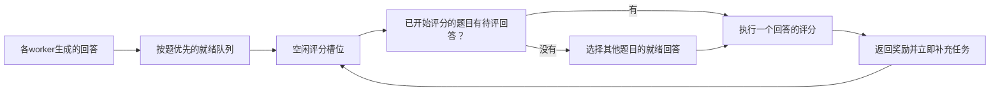

[English](R029-training-ready-reward-scheduling.md) | 中文

# R029：面向训练批次就绪的评分调度

记录日期：2026-10-22（America/Vancouver）。归属调度类，扩展 **M2：面向训练就绪的调度**，不增加第四个核心机制。
当前状态：推理／评分准入解耦与按题优先、跨题并行评分均已实现，已完成两轮固定／共享开发验证。尚不主张论文创新性已经得到证明。

## 简介与解决的问题

Code RL 的奖励通过 E2B/Kuasar
沙箱运行生成代码计算，不需要训练卡算力。原先等待评分的工作流占用推理并发名额，评分服务繁忙时会导致有空闲NPU却无法继续生成。盲目轮询派发也可能把工作交给满载
worker，而其他 worker 空闲。

解耦之后推理可以尽快完成，但按单个回答评分容易把结果分散到许多未完成题目。训练需要32道题各自8个奖励齐全，任意256个奖励并不一定能组成训练批次。因此调度目标应包括完整题目的收齐时间。

## 已有基础

1. 一道题所有回答结束生成后释放该题推理名额；评分中的工作仍受未完成数量与 offpolicy 边界约束。
1. 在可用 worker 中按生成负载选取，评分等待不再计作生成负载；已撤回的共享推理 worker 不参与派发。
1. 奖励必须完整返回后才能进入训练批次，保持回答身份与奖励对应关系。

## 当前机制：按题优先、跨题填槽

`--code-reward-scheduling question` 仅对共享组启用当前可选机制；固定组保持 `answer`，默认选项也仍为 `answer`。

每个回答生成后立即登记待评分任务，不等待整题生成。16个独立评分槽位跨 rollout worker
统一选择：优先已开始评分的题目，再按题目进入队列的顺序和回答序号选择。优先题目若只有正在评分或尚未生成的回答，就取其他题目的回答填空。每个评分独立完成、独立返回，题目之间不设置完成屏障。

SQLite
只保存调度元数据，生成代码与评分回调保留在原进程。短事务完成选择，数字文件锁维持实验内总共16个评分槽位。元数据操作不阻塞推理事件循环，也不占用评分线程。已领取槽位后调用
`grade_in_slot`，避免重复获取容量。

## 优化点与难点

核心目标是让训练所需的完整题目尽快收齐，同时保持评分服务有可用任务就继续执行。按题优先描述选择顺序，按回答准入描述容量分配，两者可以同时满足。配合推理／评分准入解耦，避免沙箱等待阻塞模型生成。这是M2的具体实现，不应将支持性工具包装成研究贡献。

必须跨进程协调，单个线程池无法控制全局顺序。取消等待中的请求可以移除队列记录；已经运行的沙箱请求必须结束后才释放槽位。存活锁用于清理死亡进程的遗留队首，调度器自身异常也需要清理状态。评分错误继续作为基础设施错误抛出，不转成零奖励。调度不依据奖励值选择题目。

## 代码位置

- `areal/infra/generation_admission.py`、workflow context与grouped workflow：生成结束聚合。
- `staleness_manager.py`、workflow executor、rollout
  controller与`borrowed_rollout.py`：生成准入和负载派发。
- `benchmark/npu_share/templates/question_rewards.py`：跨进程调度元数据、按题优先与逐回答容量管理。
- `code_workflow.py`、`code_reward.py`：评分入口及工作流适配。
- `benchmark/npu_share/run_bench.py`：固定基线与共享可选策略的配置记录。
- `benchmark/npu_share/test_question_rewards.py`：部分生成、跨题重叠、并发限制、取消与异常测试。

## 验证与证据

10项评分测试和15项运行器测试已通过。已用96题、每批32题、每题8个回答、16题并发、3批、offpolicy2、FSDP、双NPU和graph推理完成两轮复用vLLM的固定／共享对照。观察前两批开训时间、整题收齐次数、评分槽位利用率、服务耗时、总耗时、tokens与失败数量。

开发阶段复用vLLM，正式确认应独立启动。外部沙箱非独占，生成代码及其执行成本也可能变化，不能把全部耗时变化归因于调度。推理／评分解耦的动机证据保存在[证据目录](../experiments/evidence/r029-20261022)。

## 边界

协调器要求各worker共享本地文件系统，不支持跨节点统一协调，也不限制其他会话的沙箱访问。调度会改变哪些题目先进入训练，长期训练质量、版本年龄分布需单独验证。当前队列优先级不是通用的分布式公平性保证。题目元数据保留至rollout进程结束，长期驻留服务需要增加有界清理。基准运行、图表及报告属于实验工具。

## 开发验证结果

[完整对照报告](../experiments/2026-10-22-r029-work-conserving.zh.md)。4次运行全部成功，每次96题、768次评分，无评分基础设施异常，实际评分并发峰值为4。共享槽位利用率99.21%／99.29%，不同题目评分重叠169.11／181.54秒。第一批训练分别提前28.64／31.27秒；第二批在第1轮提前17.22秒，第2轮反而晚2.22秒。

第1轮固定／共享耗时518.85／557.16秒，第2轮543.32／538.70秒。共享分别慢7.38%和快0.85%，尚未证明稳定的整轮加速。第1轮剩余差距主要体现在评分服务总工作量，并非槽位空闲。生成代码和共享沙箱负载存在差异，不能直接作因果归因。保留为可选机制，固定基线及默认answer策略不变。

## 评分容量默认值更新（2026-10-23）

评分适配器统一采用
`DEFAULT_REWARD_CONCURRENCY = 8`，按回答线程池、按题优先线程池和跨进程槽位均使用该值。每组总共8个槽位，不是每个worker增加8个。此前报告保持原4并发条件。相同128个回答按4/8/8/4回放，平均评分总耗时74.99/37.85秒，无基础设施错误或评分差异。这是容量调整，不能单独算作按题调度创新。8并发完整RL已完成一轮：固定299.44秒，共享295.38秒；第二轮按用户要求取消，未启动。各768次评分、无基础设施错误、峰值8。相比前一轮518.85/557.16秒，分别缩短42.29%/46.98%；生成内容与外部沙箱负载不同，不能严格作单因素因果归因。

## 16并发默认值（2026-10-23）

当前统一常量改为
`DEFAULT_REWARD_CONCURRENCY = 16`，两种评分策略及跨进程准入共同使用；上面的8并发结果保留为历史记录。同脚本回放中16并发未出现错误，20及以上出现过上传失败。一轮16并发固定/共享已完成：272.39/266.61秒，相比8并发299.44/295.38秒减少9.04%/9.74%。两组均768次评分，无基础设施错误，峰值16；共享比固定快2.12%。生成回答与共享服务波动限制因果归因。
